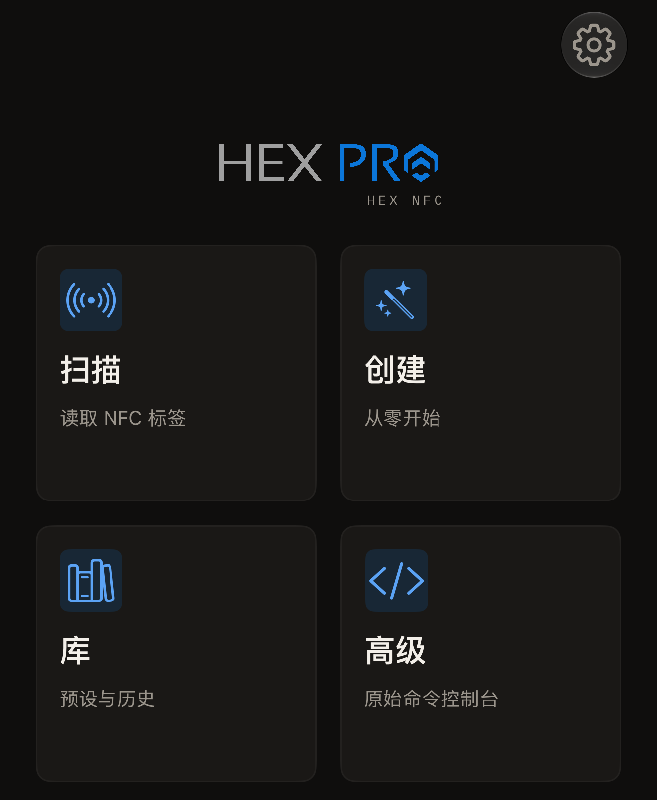

Hex NFC 可以读取你身边的 NFC 标签，并显示标签中的每一条记录。它可以将记录写入空白标签，也可以为支持密码的芯片设置密码。这款应用还能读取日本的交通卡和电子护照中的芯片。使用时无需创建账户，应用中也没有任何分析统计。

## 所需条件

- 从 [App Store](https://apps.apple.com/app/id6801457461) 安装到 iPhone 上的 Hex NFC。
- 一部运行 iOS 17 或更高版本的 iPhone。
- 一枚 NFC 标签。大多数空白贴纸、卡片和钥匙扣中的芯片，这款应用都能读取。[适用于 Hex NFC 的标签](tags-that-work.md)列出了这些芯片，[芯片支持矩阵](../developer/chip-support-matrix.md)则说明每种芯片能做什么。

## 可以做什么

Hex NFC 打开后显示的是它的主屏幕，上面有四个图块。

- 点按**扫描**可读取标签并查看其中的内容，详见[扫描标签](scan-a-tag.md)。[交通卡](transit-cards.md)的读取方式相同，[护照](passports.md)则需要贴合两次。
- 点按**创建**可从零开始组合记录，然后写入标签，详见[将链接写入标签](write-a-link.md)。
- 点按**库**可查看以前扫描过的标签，详见[查找以前扫描过的标签](scan-history.md)。你保存的记录组也在这里，详见[将标签另存为预设](presets.md)。
- 点按**高级**可打开原始命令控制台，向你了解其命令集的芯片发送原始命令，详见[向标签发送原始命令](advanced-console.md)。

:::figure[Hex NFC 主屏幕上有四个图块：**扫描**、**创建**、**库**和**高级**。]

:::

## 更改标签的内容

打开标签后，可以按照[编辑标签的记录](edit-records.md)重新组合其中的记录，可选的种类见[记录类型](record-types.md)。[用密码保护标签](protect-a-tag.md)介绍如何设置芯片要核对的密码或密钥。[移除标签的密码](remove-password.md)介绍如何再将其移除。[限制密码错误次数](attempt-limit.md)说明芯片最多容许多少次密码错误。有三个工具直接作用于标签本身：[擦除或格式化标签](erase-or-format.md)、[永久锁定标签](permanent-lock.md)和[保存标签内存的副本](memory-dump.md)。

## 开始使用

[读取你的第一枚标签](quick-start.md)带你从主屏幕开始，大约 5 分钟就能完成第一次扫描。[标签保护](tag-protection.md)解释密码保护的是什么，以及丢失的密码为什么无法找回。标签不应答时，请参阅[标签无法扫描或写入时](troubleshooting.md)。[设置](settings.md)列出应用中的每个开关，[隐私与你的数据](privacy.md)说明哪些内容留在 iPhone 上，[常见问题](faq.md)解答使用这款应用的费用问题。
