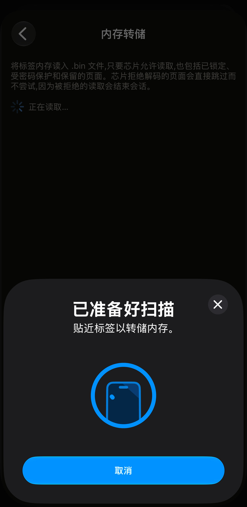
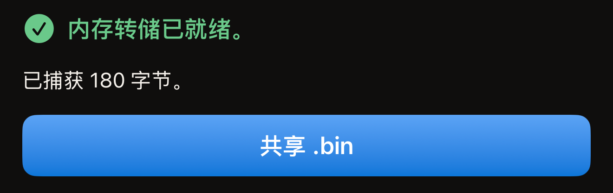
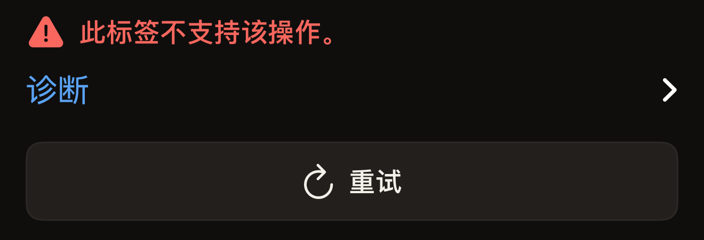

内存转储会把标签的各页复制到一个 `.bin` 文件中，并将该文件交给 iOS 的共享表单。它只读取，标签在转储前后完全一样。转储需要贴合标签一次；如果标签的密码同时保护读取，则需要贴合两次。整个过程不会要求你输入标签的 UID。

你需要一部支持 NFC 的 iPhone、从 App Store 安装的 Hex NFC，以及手边要转储的标签。如果你之前从未用这个应用读取过标签，请先阅读[读取你的第一枚标签](quick-start.md)。内存转储位于「操作」界面，该界面从「标签」界面右上角的菜单按钮打开。下面的步骤会先扫描标签，再进入这个界面。单独的扫描步骤见[扫描标签](scan-a-tag.md)。

它适用于 Hex NFC 逐页访问的芯片，即 NTAG 210µ、NTAG213、NTAG213 TT、NTAG215、NTAG216、MIFARE Ultralight EV1、MIFARE Ultralight C、EM V10、EM V11 和 EM V16。在其他任何标签上，界面都会显示“此标签不支持该操作。”

如何判断手中标签的芯片型号，见[适用于 Hex NFC 的标签](tags-that-work.md)。

## 转储标签内存

:::warning[离开界面前先发送文件]
应用不会保留转储的副本。如果你没有发送文件就关闭了共享表单，或离开了「内存转储」界面，文件就没有了，只能重新读取标签。
:::

:::::steps
::::step[打开扫描界面]
在 Hex NFC 主屏幕上，点按**扫描**。扫描界面随即打开并开始查找标签。
::::

::::step[将标签贴近 iPhone]
将 iPhone 顶部平贴在标签上，保持不动约一秒。「标签」界面随即打开，显示标签存储的内容。
::::

::::step[打开「操作」]
在「标签」界面上，点按右上角位于**写入**左侧的菜单按钮。菜单中有两行：**另存为预设…**和**操作…**。点按**操作…**。
::::

::::step[开始转储]
点按**内存转储**。界面打开后立即开始扫描，中间没有确认步骤。
::::

::::step[再次将标签贴近 iPhone]
再次将 iPhone 顶部贴在标签上。等待期间，状态行显示“将标签贴在 iPhone 顶部。”标签应答后，状态行变为“正在读取…”。最后显示“内存转储已就绪。”并在下方列出捕获的字节数。

:::figure[读取标签期间，iOS 面板上仍显示“贴近标签以转储内存。”面板后方的状态行显示“正在读取…”。]

:::

如果标签的密码同时保护读取，转储会在读取任何内容之前停下。一张标题为“标签已受保护”的卡片会要求你输入标签的密码或密钥。输入后点按**解锁并导出**，然后再次将标签贴近 iPhone。
::::

::::step[共享文件]
点按**共享 .bin**，然后选择文件的发送位置。只有读取完成后才会出现这个按钮。

:::figure[读取完成后显示“内存转储已就绪。”下方是字节数，再下方是**共享 .bin**。]

:::
::::
:::::

## 文件包含的内容

文件是从第一页开始逐页复制的芯片内存，每页 4 字节，没有文件头，也没有添加任何内容。只要芯片允许读取，已锁定、受密码保护和保留的页都会包含在内。芯片拒绝解码的页会被跳过，不去请求读取，因为一次被拒绝的读取就会结束会话，转储的其余部分也就拿不到了。在 MIFARE Ultralight C 上，复制会在最后四页之前停止，这几页存放芯片的密钥，对任何读取都不应答。

每种芯片的完整转储大小是固定的，因此根据“内存转储已就绪。”下方的字节数，就能判断是否转储完整。「标签」界面在标签信息卡片顶部列出芯片名称，所用文字与下表第一列相同。MIFARE Ultralight EV1 会在那里注明它是两种容量中的哪一种。

:::table[完整转储的字节数]
| 芯片 | 完整转储 |
| :--- | ---: |
| NTAG 210µ、EM V10、EM V11、EM V16 | 64 字节 |
| NTAG213、NTAG213 TT | 180 字节 |
| NTAG215 | 540 字节 |
| NTAG216 | 924 字节 |
| MIFARE Ultralight EV1 (48b) | 80 字节 |
| MIFARE Ultralight EV1 (128b) | 164 字节 |
| MIFARE Ultralight C | 176 字节 |
:::

Hex NFC 会把文件写入临时存储，文件名包含读取的日期和时间。只有共享出去，文件才能保留下来。应用中没有转储列表，「标签」界面上也没有任何指向该文件的入口。请在离开界面之前把它发送到别处。

## 转储未完成时

转储失败时，标签保持原样，因此重新读取不会有任何损失。

- 要重新读取同一枚标签，请点按**重试**。界面会开始新的扫描。
- 要查看标签的应答内容，请展开失败提示下方的**诊断**。其中的文字可以选中并复制到错误报告中。

在读取到任何标签之前点按 iOS 面板上的取消，会返回「操作」界面。如果没有标签贴近 iPhone，面板会自行关闭，界面显示“未找到标签”，下方是**重试**。

“此标签不支持该操作。”表示芯片不在本页开头列出的范围内。NTAG424 DNA、ICODE SLIX、ICODE SLIX2、MIFARE DESFire 系列芯片和 FeliCa 都会这样应答。每种芯片能做什么，见[芯片支持矩阵](../developer/chip-support-matrix.md)。

:::figure[遇到无法转储的芯片时，界面显示“此标签不支持该操作。”下方是**诊断**和**重试**。]

:::

如果标签在读取中途断开，请参阅[标签无法扫描或写入时](troubleshooting.md)。本页未涉及的提示，也请到那里查找。

## 另请参阅

- [扫描标签](scan-a-tag.md)
- [适用于 Hex NFC 的标签](tags-that-work.md)
- [向标签发送原始命令](advanced-console.md)
