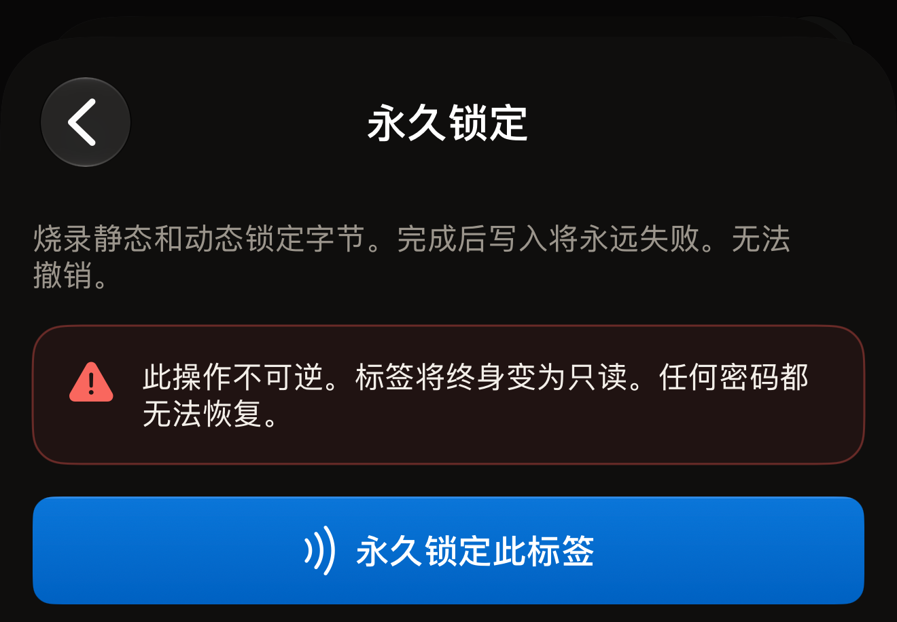
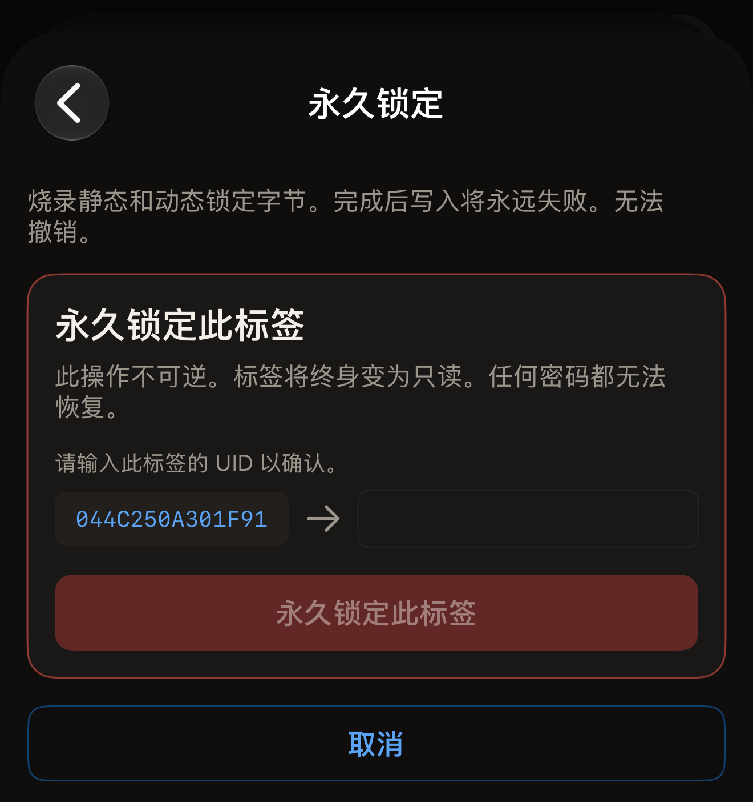
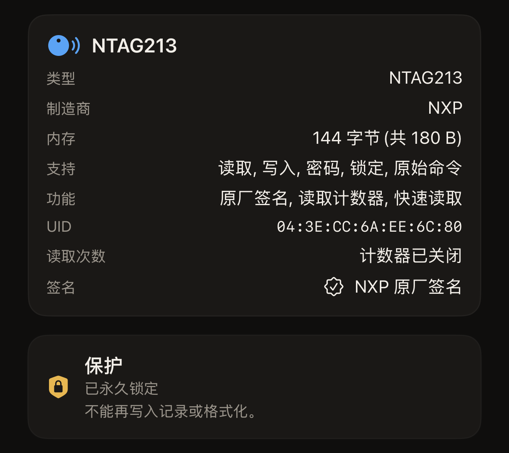

Hex NFC 可以在 iPhone 上设置芯片本身的锁定位，从而永久锁定标签。标签会保留现有的记录，但再也无法写入任何记录或格式化。读取不受影响，任何手机仍然可以读取这枚标签。

标签能否锁定取决于两点，扫描一次就能看到。在**标签**界面上，顶部卡片的标题是芯片名称，卡片中有一行**支持**。只有本应用能够锁定的芯片，这一行中才会出现“锁定”。在这张卡片下方，**保护**卡片会说明标签当前受到什么保护。“关闭”表示没有任何保护，可以进行锁定。不使用密码的芯片根本没有**保护**卡片，它上面也没有任何东西能阻止锁定。

摘要中如果提到密码或密钥，例如“密码 · 仅写入”，就表示保护已开启。处于这种状态的标签不会被锁定。应用如何告知这一点，取决于芯片。

在 NTAG 或 MIFARE Ultralight EV1 上，Hex NFC 会在写入任何内容之前先进行检查，并回答“此标签受密码保护，因此无法永久锁定。请先移除密码，再进行锁定。”在 MIFARE Ultralight C 或 ICODE SLIX2 上，应用会开始锁定。这两种芯片的摘要会提到 3DES 密钥或密码。标签自身的保护会拒绝第一次写入，这一拒绝会以“没有任何内容被锁定。”的形式返回。无论哪种情况，都不会烧录任何内容，所以这次贴合不会给标签带来任何损失。请先移除密码或密钥，具体请参阅[移除标签的密码](remove-password.md)。

阻止锁定的是已开启的保护，而不是密码本身。如果密码存储在标签上，但已不再保护任何内容，重新扫描后**保护**卡片会显示“关闭”。处于这种状态的标签可以锁定。

:::warning[已锁定的标签无法解锁]
任何密码、任何其他应用、之后的任何一次贴合，都无法撤销永久锁定。请在标签的内容最终确定之后再锁定它。
:::

## 永久锁定标签

::include[two-tap-confirmation]

:::::steps
::::step[扫描要锁定的标签]
在 Hex NFC 主屏幕上点按**扫描**，然后将标签贴近 iPhone 顶部。**标签**界面会打开，显示标签的内容。请参阅[扫描标签](scan-a-tag.md)。
::::

::::step[确认标签可以锁定]
在「标签」界面上，查看标签信息卡片的**支持**行中是否有“锁定”，以及**保护**卡片是否显示“关闭”。不使用密码的芯片不显示**保护**卡片，这也没有问题。
::::

::::step[打开「操作」界面]
在「标签」界面上，点按右上角**写入**旁边的菜单按钮，然后点按**操作…**。
::::

::::step[选择「永久锁定」]
滚动到**危险操作**，然后点按**永久锁定**。打开的界面会说明锁定的代价，并指出锁定无法撤销。每枚标签都有这个选项，包括没有锁定位的芯片。应用会在第一次贴合时检查芯片。对于无法锁定的芯片，应用会在这次贴合之后、你输入 UID 之前回答“此标签不支持该操作。”不会写入任何内容。

:::figure[**永久锁定**界面打开时会显示警告，在你点按**永久锁定此标签**之前，不会有任何内容写入标签。]

:::
::::

::::step[贴近标签进行第一次贴合]
阅读警告，然后点按**永久锁定此标签**。界面显示“第 1 次(共 2 次)。贴住标签以识别它。”此时将标签贴近 iPhone 顶部，直到面板关闭。
::::

::::step[输入标签的 UID]
标签的 UID 会显示在“请输入此标签的 UID 以确认。”下方的一个空栏旁边。它以大写字母显示，不带冒号或空格，需要完整输入。标签信息卡片上显示为 `04:BA:4A:92:1B:21:90` 的 UID，在这里显示为 `04BA4A921B2190`。大写和小写都能匹配，输入内容前后的空格会被忽略。在你输入的内容匹配之前，按钮会一直呈灰色。

:::figure[在两次贴合之间，标签的 UID 位于一个空栏的左侧，在你输入 UID 之前，**永久锁定此标签**会一直呈灰色。]

:::
::::

::::step[贴近标签进行第二次贴合]
再次点按**永久锁定此标签**，然后将标签贴近 iPhone 顶部。等待期间界面显示“第 2 次(共 2 次)。再次贴住同一个标签。”标签移开后，界面会报告结果。
::::
:::::

## 锁定完成时应用显示的内容

“标签已永久锁定。”就是你想要的结果。应用在设置锁定位之后，要求标签再接受一次写入，标签拒绝了，这次拒绝就是证明。

“锁定已写入。”表示锁定位已经写入，但这次贴合无法证实它们已生效。有些芯片要到标签下次唤醒时才会应用锁定位。应用还会补充“此芯片的锁定位要到下次贴合时才生效,因此本次会话无法验证。请再次扫描该标签,确认它现在会拒绝写入。”请再扫描一次标签，从**保护**卡片上查看结论。

在**标签**界面上，对于应用回读确认已锁定的标签，**保护**显示“已永久锁定”，下方是“不能再写入记录或格式化。”在进行确认扫描之前，它显示的是“锁定已写入 · 请再次扫描以确认”。对于回读确认已锁定的标签，**写入**不可用。

:::figure[确认扫描之后，**保护**卡片显示“已永久锁定”，下方是“不能再写入记录或格式化。”]

:::

存储在标签上的密码在锁定后仍会保留，这时卡片显示“已永久锁定 · 密码仍已设置”。下面一行会说明这个密码是否还能移除。哪些芯片可以锁定，请参阅[适用于 Hex NFC 的标签](tags-that-work.md)。

## 锁定未完成时

锁定分阶段进行。如果中途停止，应用会说明标签所处的状态，而不是笼统地报告失败。

- “没有任何内容被锁定。”芯片拒绝了每一个阶段，并明确报告了这一点。没有烧录任何内容，标签完全保持原样，所以再执行一次不会给它带来任何损失。请再次扫描标签，检查锁定所需的两个条件：**保护**卡片显示“关闭”，或者不使用密码的芯片根本不显示**保护**卡片；标签信息卡片的**支持**行中出现“锁定”。在 MIFARE Ultralight C 或 ICODE SLIX2 上，出现这条提示就说明标签受到保护。请移除密钥或密码，然后再执行锁定。
- “此标签现已部分锁定，且无法撤销。它的部分内存已永久变为只读；其余部分被拒绝，仍可写入。”芯片的一部分已经用掉，再执行一次也无法完成其余部分。回到「标签」界面，**保护**卡片会显示“部分锁定 · 此标签的一部分已永久变为只读”。仍然存有密码的标签则显示“部分锁定 · 密码仍已设置”。在 NTAG21x 或 MIFARE Ultralight 上，重新扫描会再次显示同样的结果，因为应用会回读这些芯片的锁定字节。应用在扫描时不会重新读取 ICODE SLIX2 按块设置的锁定，所以重新扫描这种芯片不会显示任何部分锁定的信息。在这种芯片上，操作结束时显示的结果是你唯一能得到的结论。
- “标签在一次无法撤销的锁定过程中停止应答，因此本应用无法判断它是否已有内存变为只读。请把这枚标签当作可能已锁定来对待。”标签在写入过程中移开了。在把这枚标签用于任何用途之前，请再次扫描它，查看**保护**卡片。
- “此标签的一部分已永久变为只读，且无法撤销。标签在其余部分得到确认之前停止应答，因此其余部分可能也已锁定。”一个阶段已得到确认，另一个阶段情况不明。请再次扫描标签，并把它当作已锁定来对待。

## 另请参阅

- [标签保护](tag-protection.md)
- [擦除或格式化标签](erase-or-format.md)
- [标签无法扫描或写入时](troubleshooting.md)
