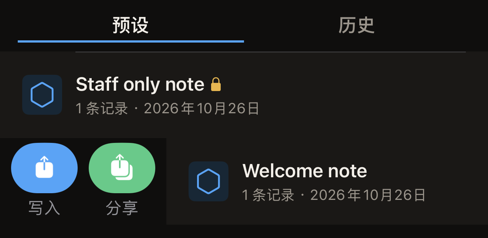
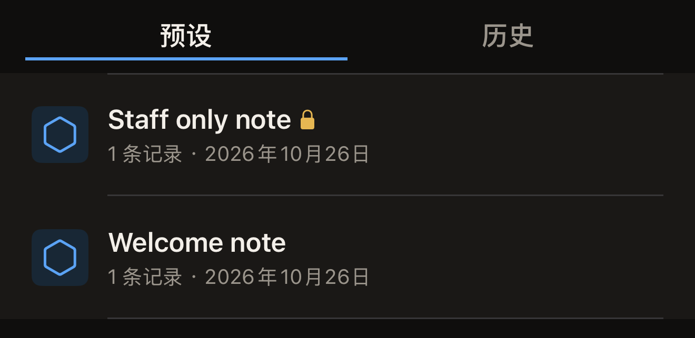

预设是保存在 iPhone 上、带有名称的一组记录。从正在编辑的标签保存一个预设，之后就能把同样的记录写入任意多枚标签，无需重新创建。

开始之前，先在「标签」界面准备好一组记录，这样才有内容可以保存。在 Hex NFC 主屏幕上点按**扫描**，然后将要复制的标签贴近 iPhone。如果手边没有标签，想从头开始，请点按**创建**。两种方式都会打开「标签」界面。请参阅[扫描标签](scan-a-tag.md)和[编辑标签的记录](edit-records.md)。

## 保存正在编辑的记录

::::steps
:::step[打开保存面板]
在「标签」界面，点按右上角的菜单按钮，然后点按**另存为预设…**。在标签至少包含一条记录或一项保护设置之前，这个菜单行呈灰色。
:::

:::step[为预设命名]
在**名称**中输入一个以后能认出来的名称，例如这些标签要放置的地方。填写名称之前，**保存**一直呈灰色。
:::

:::step[添加备注]
可选：在**备注**中写下这个预设的用途。该栏最多可输入四行。
:::

:::step[选择图标]
在**图标**下，点按三个分段之一。这些分段以文字而不是图形标示：**外框**、**向上尖角**或**向下尖角**。你点按的那一项决定了**库**中预设旁边显示的六边形徽标。
:::

:::step[检查预设将包含的内容]
**记录**会统计将要存储的记录数。如果预设只包含保护、没有其他内容，这里则显示“没有记录。此预设仅应用保护。”

如果列表中有一条既没有坐标也没有地图网址的**位置**记录，**记录**还会显示「有一条位置记录没有坐标或地图网址，因此此预设永远无法写入标签。请先在“标签”界面填写或删除该记录，然后再保存。」出现这条提示时，**保存**一直呈灰色。点按**取消**，填写或删除该记录，然后重新打开保存面板。请参阅[记录类型](record-types.md)。
:::

:::step[保存预设]
点按**保存**。面板随即关闭，预设出现在**库**中**预设**选项卡的最上方。
:::
::::

只有在保存之前为标签设置了密码或密钥，预设才会包含保护。这一步在「标签」界面完成：对于可以保护的标签，该界面会显示**保护**。点按**保护**，打开**用密码保护此标签**。在面板显示的栏中输入密码或密钥（例如**密码(4 字节)**），然后点按**完成**。请参阅[用密码保护标签](protect-a-tag.md)。

完成后，保存面板会多出一个**保护**部分，说明预设包含的保护，例如“密码保护(仅写入)”。密码或密钥本身不会存入预设，应用在同一部分中也说明了这一点：“密码或密钥仅存储在本设备(钥匙串)中。它不会同步,也不会随导出文件外流。”只有当这个密码或密钥仍保存在本机上时，预设才能为标签启用保护。如果保存预设时没有输入密码或密钥，它不会为任何标签启用保护。

如果 iPhone 拒绝保存，表单底部会出现一行红字，内容为“无法保存：”，后面是 iPhone 给出的原因。面板仍保持打开，记录也仍在「标签」界面上，因此你输入的内容不会丢失。再次点按**保存**。如果仍是同样的原因，请点按**取消**。记录仍在「标签」界面上，你可以直接把它们写入标签，而不必保存为预设。

## 将预设写入标签 {#write-a-preset-to-a-tag}

预设名称旁的锁形图标表示它包含保护设置。该行显示的信息仅此而已：它不会告诉你这次写入是否会为标签启用保护，因为这取决于与预设一同保存的密码或密钥，而密码或密钥不会显示出来。如果你在本机上输入了自己的密码或密钥后保存预设，预设就带有这个密码或密钥，并会为标签启用保护。如果预设保存自一枚已受保护的标签，而你从未输入过它的密码，预设就不带任何密码或密钥，只会写入记录，不保护任何内容。如果分不清眼前是哪一种，就当作会启用保护的那一种。

:::::steps
::::step[打开「库」]
在主屏幕上点按**库**。「库」界面打开后显示**预设**，最近更改的预设位于最上方。
::::

::::step[开始写入]
从预设的左边缘向右轻扫一小段，然后点按**写入**。**库**随即关闭，写入界面打开。

:::figure[从预设的左边缘轻扫一小段，即可显示**写入**和**分享**。]

:::
::::

::::step[将标签贴近 iPhone]
界面显示“将标签贴近 iPhone 顶部”时，将标签贴近 iPhone 顶部。记录写入标签后，界面显示“写入完成”。
::::
:::::

:::warning[应用保护的预设不会要求你确认标签]
如果预设包含保护设置，且它的密码或密钥仍保存在本机上，它会把这个密码或密钥设置到你贴近的任何一枚标签上。在应用中，只有这里会在没有第一次贴合读取标签的情况下启用保护，也无需回输 UID 进行确认。只贴近你打算保护的标签。只要这些标签还在使用，就请保留这个预设：要重新解锁它保护过的标签，办法就是再次写入这个预设。删除预设，也会删除这份密码或密钥。
:::

## 管理预设

在你保存第一个预设之前，**预设**选项卡显示“没有已保存的预设”。保存之后，每一行都会显示预设的名称和图标，下方一行显示记录数和预设最后一次更改的日期。

名称旁的锁形图标表示该预设包含保护设置，VoiceOver 会将它读作“应用保护”。这个锁形图标能说明什么、不能说明什么，见上文的[将预设写入标签](#write-a-preset-to-a-tag)。

:::figure[预设名称后的锁形图标表示该预设包含保护设置。]

:::

从预设的左边缘轻扫，会显示**写入**和**分享**；从右边缘轻扫，会显示**删除**和**复制**。轻扫一小段，然后点按需要的按钮。如果从右边缘一直轻扫到底，预设会直接被删除。

已保存的预设无法更改。要更改没有锁形图标的预设的内容，请在「标签」界面重新创建这些记录，将其另存为新预设，然后删除旧预设。

带锁形图标的预设请保持原样。除非先重新设置密码或密钥，否则在「标签」界面重建它，只会得到记录，没有密码或密钥。删除旧预设，会带走能打开它所保护标签的唯一一份密码或密钥。如需再要一份，请使用**复制**，它会把存储的密码或密钥一并复制过去。

在**预设**选项卡中，可以进行以下操作：

- 要在应用之外保留预设的副本，请从左边缘轻扫该预设，然后点按**分享**。应用会生成一个以预设名称命名的 `.hexnfc` 文件，并交给共享表单。记录和保护设置会随该文件一起传送，密码或密钥则永远不会。Hex NFC 无法打开 `.hexnfc` 文件。你发给别人的是一份留存用的记录副本，而不是对方可以添加到自己应用中的预设。
- 要再复制一份预设，请从右边缘轻扫该预设，然后点按**复制**。副本包含相同的记录、相同的保护设置和相同的已存储密码或密钥。
- 要移除预设，请从右边缘轻扫该预设，然后点按**删除**。不会要求你确认，预设存储的密码或密钥也会随之删除。

## 另请参阅

- [编辑标签的记录](edit-records.md)
- [将链接写入标签](write-a-link.md)
- [标签保护](tag-protection.md)
- [查找以前扫描过的标签](scan-history.md)
