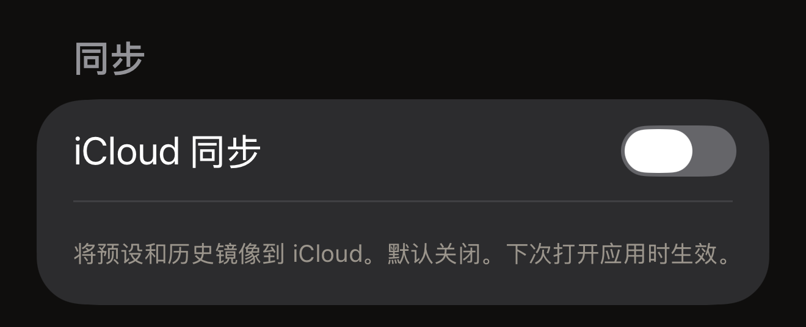

将标签贴近 iPhone，标签中的内容就会显示在屏幕上。读取在 iPhone 上完成，结果也保留在 iPhone 上。Hex NFC 没有账户，也没有分析统计。它会向 Hex Pro 自有服务器发出四类请求：其中三类不包含任何关于你的信息，第四类是反馈留言，只包含你选择发送的内容。隐私政策的全文就在应用中：在 Hex NFC 主屏幕上点按右上角的齿轮按钮，然后在**法律信息**下点按**隐私政策**。

## 保留在 iPhone 上的内容

你的扫描历史和已保存的预设存放在本机的本地数据库中，你的设置也存储在本地。那张不时询问**喜欢 Hex NFC 吗？**的卡片所依据的一切同样存储在本地：它是否已经询问过、你如何回答，以及决定它何时可以再次询问的近期写入和读取次数。[设置](settings.md#feedback-and-ratings)介绍了这张卡片。删除某一项，就会将其从该数据库中移除。删除应用时，应用的本地数据也会一并删除。

标签密码与上述内容分开存放，保存在设置这些密码的那台 iPhone 的 iOS 钥匙串中。密码从不同步，从不写入你导出的文件，也从不发送到任何地方。应用会存储两类钥匙串项目。一类针对通过写入应用了保护的标签，按该标签的 UID 存储；这种写入是从「标签」界面的**保护**卡片，或者从应用保护的预设发起的。另一类针对应用保护的预设，按该预设存储。两类项目都不包含任何关于你的信息。你在**操作…** > **用密码保护**中输入的密码不会存入其中任何一类，因此请自行保存一份。删除应用不会删除已存储的密码，因为应用删除后，iOS 仍会保留钥匙串项目。护照的读取结果不会保存在任何地方。芯片返回的内容只在该会话期间显示在屏幕上，会话结束即消失。[读取护照](passports.md)对此有完整说明。

有两种情况会清除已存储的密码。一是删除预设，与预设一同保存的密码会随之删除。无论写入过该预设的标签是否仍受保护，都会如此。这样一来，标签可能仍受密码保护，而应用已不再保存这个密码。二是在标签的**保护**卡片上关闭保护，然后写入标签，具体见[移除标签的密码](remove-password.md)。即便如此，应用也只有在回读标签后才会删除密码。回读必须确认以下两点：

- 保护已解除。
- 标签的密码已恢复为芯片的出厂默认密码。

如果移除只确认了第一点而没有确认第二点，已存储的密码会保留。一枚已解除保护但仍保存着你的密码的标签，没有这个密码就无法重新设置保护。从**操作**运行的移除不会清除钥匙串中的任何内容，已为该标签存储的项目会原样保留。

Hex NFC 中没有任何地方会列出它保存了密码的标签。对于无法再次贴合的标签，无法在应用内清除它已存储的密码。该钥匙串项目会一直留在本机上，除非之后的某次移除将其清除，或者你抹掉这台 iPhone。

**iCloud 同步**默认关闭，切换开关后，在下次打开应用时生效。打开后，你的预设和扫描历史会镜像到你的私有 iCloud 数据库中，该数据库由 Apple 运营，并受你的 Apple ID 保护。Hex Pro 无法读取其中的内容。无论开关状态如何，标签密码都不会进入该数据库。这个开关位于[设置](settings.md)中。

:::figure[**iCloud 同步**在你打开之前一直处于关闭状态，下方的文字说明更改要等到下次打开应用时才生效。]

:::

关闭同步后，只有在你关闭并重新打开 Hex NFC 之后镜像才会停止，具体见[关闭并重新打开应用](settings.md#close-and-reopen-the-app)。回到 iPhone 主屏幕时，应用仍在运行，镜像也会继续。

停止镜像并不等于移除 iCloud 中已有的内容，删除应用也不会移除这些内容。要删除这份副本，请在 iPhone 上打开“设置”应用，点按顶部你的名字，然后点按 iCloud 一行。逐项查看其中列出的储存空间，可以在那里删除各个应用保存的数据。

:::note[标签不是私密存储]
你写入标签的任何内容都存放在 iPhone 之外的硬件上，任何拥有读取设备的人都能读取未受保护的标签。除非你为标签设置了保护，否则请将标签中的内容视为公开信息。关于如何保护标签，请参阅[标签保护](tag-protection.md)。
:::

## 应用访问 Hex Pro 的四种情况 {#when-the-app-reaches-hex-pro}

这些请求都不会在后台运行。前三种不包含任何能识别你身份的信息。

- 主屏幕会从 api.apps.hex.pro 获取一个关于本项目开发成本的公开数字。该请求不包含任何个人数据。
- 当你对交通卡上的某个未知站点点按**提交**时，会发出一条站名建议。在名称栏处于打开状态时点按键盘上的发送键，也会发出建议。建议中包含线路、车站和区域代码、卡片的系统代码，以及你输入的名称。卡片的序列号、余额和乘车历史不在其中，因此请不要在名称栏中填写个人信息。
- **更多 Hex Pro 应用**卡片会从 api.p.hex.pro 获取另一款 Hex Pro 应用的横幅。请求会发送本应用的套装 ID、平台和一个展示位名称。返回的内容指明一张图片或一段视频，应用会从另一个地址下载它，并保存在 iPhone 上。所有人看到的横幅都一样。横幅背后没有广告网络、追踪标识符或个性化。
- 当你在**发送反馈**表单上点按**发送**时，会发出一条反馈留言。其中包含你的留言、你填写的电子邮件地址（如果你填写了），以及表单在**随留言一起发送**下列出的四项信息：应用版本、iOS 版本、设备型号和语言。它会发送到 api.hex.pro，再转到 Hex Pro 的反馈收件箱，最多保留 24 个月，绝不会用于营销。其中不包含来自你的标签、扫描或扫描历史的任何内容。

iCloud 同步是另一项使用网络的功能，也是上面那段说明的例外。打开后，你的预设和扫描历史会在后台于 iPhone 与 Apple 之间传输。这些数据都不会到达 Hex Pro。

任何互联网请求都会让响应它的服务器看到你的 IP 地址。Hex Pro 只保留短期的运行日志，不会利用 IP 地址识别任何人或建立用户画像。反馈留言会连同经过混淆处理的 IP 地址一起存储，它只用于防止同一个连接发送过多留言，并会在 7 天内删除。

## 每项权限的用途

Hex NFC 会向你请求两项权限。NFC 是它离不开的一项，iOS 没有为它提供开关。相机是可选的，iOS 会在你第一次扫描二维码或护照照片页时请求相机权限。两者获取的内容都保留在 iPhone 上。

应用中的隐私政策还介绍了另外三项权限：通讯录、位置和蓝牙。应用中没有任何功能会请求这三项权限，因此 iOS 永远不会就它们向你发出提示。

:::table[Hex NFC 请求的权限]
| 权限 | 用途 |
| :--- | :--- |
| NFC | 读取和写入标签，仅在扫描界面或写入界面打开时使用。 |
| 相机 | 扫描你选择转换为记录的二维码，以及在你选择扫描时读取护照的照片页。画面从不保存或上传。 |
:::

## Hex Pro 绝不会做的事

Hex NFC 不包含任何分析统计或遥测 SDK，也没有第三方广告，其中也没有任何内容会对 iPhone 进行设备指纹识别。Hex Pro 不会出售、出租或共享个人信息。由于没有账户，Hex Pro 的服务器上不会有你的个人资料。你导出的文件包含你选择的记录和预设，绝不会包含标签密码。

## 另请参阅

- [设置](settings.md)
- [读取交通卡](transit-cards.md)
- [读取护照](passports.md)
- [标签保护](tag-protection.md)
