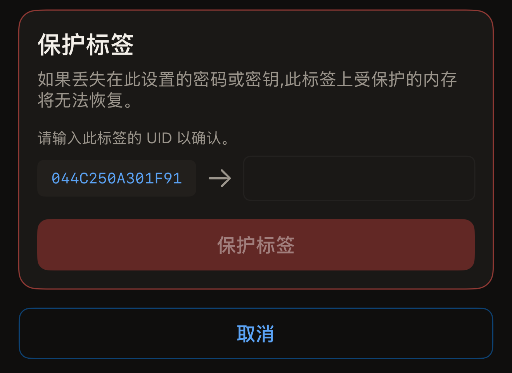
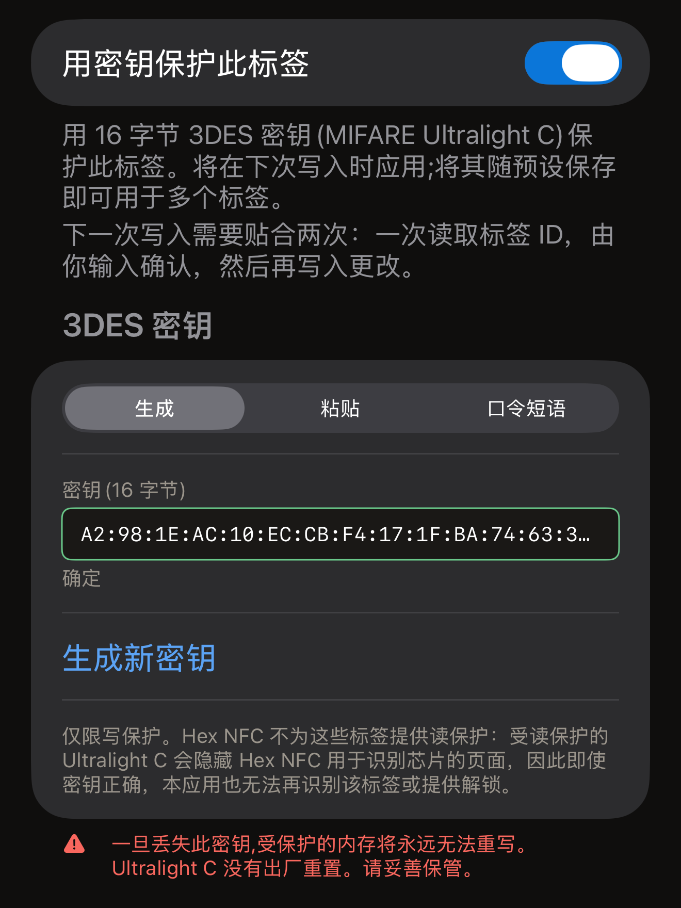
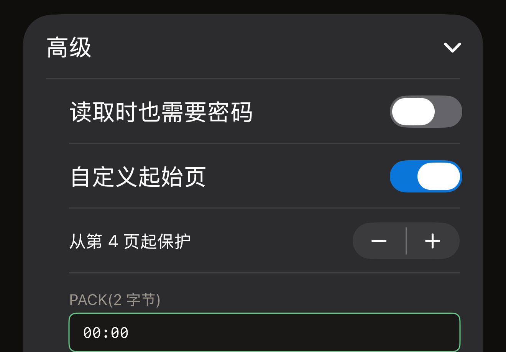

标签上的密码保护写入。除非你把读取也保护起来，否则任何人仍然可以读取其中的记录。在发送密码之前，写入会被拒绝。Hex NFC 可以通过两种方式在 iPhone 上设置密码，两种方式适用的芯片相同。**操作…**下的**用密码保护**以一项单独的操作保护标签。「标签」界面上的**保护**卡片则在下一次写入时把密码或密钥一并写入标签。如果只想保护标签而不更改其他内容，请通过「操作」界面进行；如果本来就要写入标签，请使用「保护」卡片。

开始之前，先扫描要保护的标签，让它在「标签」界面中打开。请参阅[扫描标签](scan-a-tag.md)。该界面顶部卡片的第一行是芯片名称，这个名称说明了标签使用哪种密码或密钥。

应用可以保护七种芯片：NTAG213、NTAG215、NTAG216、MIFARE Ultralight EV1、MIFARE Ultralight C、NTAG424 DNA 和 ICODE SLIX2。要确定你手中的标签究竟能否受保护，请参阅[芯片支持矩阵](../developer/chip-support-matrix.md)。在其他芯片上，**用密码保护**最终会显示“此标签不支持该操作。”对于这些芯片，「标签」界面上也不会显示**保护**卡片，除非标签报告了锁定。

::include[two-tap-confirmation]

## 通过「操作」界面保护标签

这种方式在第一次贴合之前不需要你输入任何内容。这次贴合会读出标签是哪种芯片，随后界面会要求输入该芯片使用的密码或密钥：NTAG213、NTAG215、NTAG216、MIFARE Ultralight EV1 或 ICODE SLIX2 使用 4 字节密码，NTAG424 DNA 或 MIFARE Ultralight C 使用 16 字节密钥。各芯片支持的内容请参阅[芯片支持矩阵](../developer/chip-support-matrix.md)。

:::::steps
::::step[打开「用密码保护」]
在「标签」界面上，点按右上角**写入**旁边的菜单按钮，然后前往**操作…** > **用密码保护**。
::::

::::step[贴近标签以便应用识别]
点按**保护标签**。扫描面板随即打开，界面显示“第 1 次(共 2 次)。贴住标签以识别它。”将标签贴近 iPhone 顶部，直到面板关闭。
::::

::::step[输入新密码或密钥]
界面会在“已识别标签:”后面显示读到的芯片名称，并列出该芯片需要的栏。以十六进制输入密码或密钥，字节之间可以带冒号，也可以不带。

- 在 NTAG213、NTAG215、NTAG216 或 MIFARE Ultralight EV1 上，在**密码(4 字节)**栏中输入密码。如果读取结果显示标签未受保护，这个栏一开始填的是出厂默认值 `FF FF FF FF`，请换成你自己的密码。PACK 是标签接受密码时回传的 2 个字节，读取设备会检查它，以确认自己正在与预期的标签通信。**PACK(2 字节)**一开始是两个零字节，除非你使用的系统要求特定的值，否则保持不变就是正确的选择。
- 在 NTAG424 DNA 上，在**密钥(16 字节)**栏中输入密钥。
- 在 ICODE SLIX2 上，在**密码(4 字节)**栏中输入写入密码。读取保持开放。
- 在 MIFARE Ultralight C 上，密钥填入**密钥(16 字节)**栏。如果读取结果显示标签未受保护，这个栏一开始就填有随机生成的密钥。这种芯片只能设置写保护。

在 NTAG21x、MIFARE Ultralight EV1 或 NTAG424 DNA 上，栏下方还有一个开关，可以把读取也保护起来。它显示为**读取时也需要密码**，在 NTAG424 DNA 上则是**读取时也需要密钥**。保持关闭，任何读取设备仍然可以读取标签。打开后，没有密码或密钥就读不出标签上的任何内容，因此之后在 Hex NFC 中扫描时，应用会先要求你提供。这次操作本身仍以“密码已设置。”结束，因为应用会发送刚写入的密码或密钥来完成自己的回读。
::::

::::step[输入标签的 UID]
在这些栏下方，标题为**保护标签**的卡片会提示“请输入此标签的 UID 以确认。”并在一个空栏旁边显示应用在那次贴合中读到的 UID。如果标签已经设置了密码或密钥，这张卡片上方还会有一张标题为“标签已受保护”的卡片，要求输入标签当前的密码或密钥。将这个 UID 逐个字符输入栏中，然后点按**保护标签**。

:::figure[要照抄的 UID 位于**保护标签**卡片左侧，输入它的栏在右侧。]

:::
::::

::::step[再次贴近同一枚标签]
界面显示“第 2 次(共 2 次)。再次贴住同一个标签。”再次将标签贴近 iPhone。应用回读标签的配置并确认保护已开启后，会显示“密码已设置。”
::::
:::::

:::warning[保管好密码]
应用中没有任何功能能从标签上回读密码，所以你保存的那份就是唯一的副本。界面上的警告说明了原因：“如果丢失在此设置的密码或密钥,此标签上受保护的内存将无法恢复。”
:::

如果操作失败，界面会提供**重试**，它会让界面回到初始状态，以便你从第一次贴合重新开始。UID 卡片显示期间，**取消**会让界面回到初始状态。标签保持原样，仍然打开的扫描面板会显示“已取消。”并关闭。

对于已受保护的标签，这种方式需要两个密码或密钥：新的填在那些栏中，标签当前的填在“标签已受保护”卡片中。标签当前的密码或密钥用来打开它，新的则取而代之。

## 通过「保护」卡片设置密钥 {#protection-card}

NTAG424 DNA 和 MIFARE Ultralight C 使用 16 字节密钥，而不是密码。ICODE SLIX2 使用它自己的写入密码。这三种都可以在「标签」界面的**保护**卡片上设置，密码或密钥会在下一次写入时一并写入。Type 2 密码也可以在这张卡片上设置。

:::::steps
::::step[打开「保护」卡片]
在「标签」界面上，点按显示芯片名称的卡片下方的**保护**卡片。
::::

::::step[打开保护]
打开卡片顶部的开关。在 NTAG424 DNA 或 MIFARE Ultralight C 上，它显示为**用密钥保护此标签**；在使用密码的芯片上，它显示为**用密码保护此标签**。
::::

::::step[输入密钥或密码]
填写卡片为该芯片显示的栏。

- 在 NTAG424 DNA 上，在**密钥(16 字节)**栏中输入 16 个字节，或点按**生成随机密钥**。如果还要保护读取，请打开**读取时也需要密钥**。
- 在 MIFARE Ultralight C 上，在 **3DES 密钥**下方的选择器中选择密钥的生成方式。在尚无密钥的标签上，卡片打开时选中的是**生成**，**密钥(16 字节)**栏中已填好 16 个随机字节，点按**生成新密钥**会替换它们。选择**粘贴**，可以在**密钥(16 字节)**栏中填入你自己的 16 个字节。使用**口令短语**时，同一个口令短语每次都会生成相同的密钥。
- 在 ICODE SLIX2、NTAG213、NTAG215、NTAG216 或 MIFARE Ultralight EV1 上，在**密码(4 字节)**栏中输入 4 个字节。

在 NTAG213、NTAG215、NTAG216 或 MIFARE Ultralight EV1 上，栏下方的**高级**中有读保护、页范围和 PACK 三项设置。如果需要其中任何一项，请在进行下一步之前打开它。请参阅[选择 Type 2 密码保护的页](#pages-a-type-2-password-covers)。

栏中填入完整的密钥或密码后，顶部开关下方的说明会告诉你下一次写入需要什么。它写着：“下一次写入需要贴合两次：一次读取标签 ID，由你输入确认，然后再写入更改。”

:::figure[在未受保护的 MIFARE Ultralight C 上，**3DES 密钥**下方的选择器初始选中**生成**，因此**密钥(16 字节)**栏中已有一个随机密钥。]

:::
::::

::::step[保存设置]
点按右上角的**完成**。此时还没有任何内容写入标签。
::::

::::step[开始写入]
点按「标签」界面右上角的**写入**。将标签贴近 iPhone 顶部，完成读取其 UID 的那次贴合。
::::

::::step[确认标签并再次贴近]
标题为**保护标签**的卡片会在一个空栏旁边显示应用在那次贴合中读到的 UID。将这个 UID 输入栏中，点按**保护标签**，然后再次贴近同一枚标签。之后，**保护**卡片会概括标签当前受到的保护。
::::
:::::

这张卡片上的警告因芯片而异。NTAG424 DNA 密钥的警告是“一旦丢失此密钥,你将永远无法重写此标签。NTAG424 没有出厂重置。请妥善保管。”MIFARE Ultralight C 密钥的警告是“一旦丢失此密钥,受保护的内存将永远无法重写。Ultralight C 没有出厂重置。请妥善保管。”密码的警告是“一旦丢失此密码,此标签上受保护的内存将无法恢复。”

对于已经设置了密码的标签，应用会用卡片中填写的密码打开它。在卡片中输入标签当前的密码，第一次贴合就会解锁标签，之后无需再回应任何提示。

如果卡片中没有能打开标签的密码，第一次贴合就会遇到保护。写入会停下来，在“标签已受保护”标题下要求你输入那个密码。栏上方的说明会告诉你接下来还有哪些步骤。它写着：“更改保护需要贴合标签两次：第一次读取标签 ID 供你确认，第二次执行更改。”

在这里输入密码不会多出一次贴合，因为应用已经拿到了标签的 ID。按钮显示为**解锁并继续**，接下来是 UID 卡片。

## 选择 Type 2 密码保护的页 {#pages-a-type-2-password-covers}

在「保护」卡片上点按**完成**之前，先打开**高级**。在 NTAG213、NTAG215、NTAG216 或 MIFARE Ultralight EV1 上，这里还有三项设置：

- 如果要同时保护读取和写入，请打开**读取时也需要密码**。卡片会提示：“读保护的标签在没有密码时无法回读,包括校验在内。”
- 如果只想保护标签的一部分而不是全部，请打开**自定义起始页**，然后把**从第 4 页起保护**设为你想保护的第一页。一页就是标签内存中的 4 个字节。这项设置的范围是 3 到 254，这是它适用的所有芯片的范围，而不是你手中这枚标签的范围，应用也不会按标签调整它。如果起始页超出了芯片内存的末尾，密码会被写入，但什么也不保护。写入仍会以成功界面结束，所以界面上没有任何信息表明标签并未受到保护。只有重新扫描才能看出标签什么也没有保护。请选择芯片内存范围内的页；[芯片支持矩阵](../developer/chip-support-matrix.md)列出了每种芯片的内存大小。这项设置保持关闭时，说明为“保护整个数据区(从芯片的第一个数据页起)。”
- 如果要自行指定与密码一起存储的 2 个字节，请在 **PACK(2 字节)**栏中输入。

:::figure[打开**自定义起始页**后，**高级**会在 **PACK(2 字节)**上方显示起始页及其加减按钮。]

:::

芯片能接受多少次密码错误，需要在别处设置。请参阅[限制密码错误次数](attempt-limit.md)。

## 应用无法确认结果时

保护操作的最后一步是回读标签的配置，所以应用绝不会仅凭标签的确认应答就判定操作成功。如果只能确认一半，提示会说明是哪一半。

界面显示以下任一提示时，标签已受保护：

- “密码已设置。”
- “保护已开启，但本应用无法确认密码是否已生效。请保留你输入的密码：它极有可能就是标签现在持有的密码。”

界面显示以下任一提示时，标签未受保护：

- “标签仍未受保护，你输入的密码也没有保存到标签上。请再次将标签贴近手机后重试。”
- “密码已保存到标签。保护仍处于关闭状态。”
- “密码已保存到标签，但保护未开启。请再次将标签贴近手机以完成操作。”
- “标签仍未受保护，本应用也无法确认它现在持有哪个密码。请同时保留你输入的密码和它之前的密码，然后再次将标签贴近手机。”

界面显示以下任一提示时，标签是否受保护尚无定论：

- “无法确认保护是否已开启。请再次将标签贴近手机进行检查。”
- “无法确认保护是否已开启，也无法确认标签现在持有哪个密码。请同时保留你输入的密码和它之前的密码，然后再次将标签贴近手机。”

如果提示要求再贴近一次，请再次贴近标签，并保留两个密码，直到其中一个打开了标签。有两条提示没有提出任何要求，它们各有各的下一步。

- 出现“密码已保存到标签。保护仍处于关闭状态。”后，标签上存有你输入的密码，但没有保护任何内容。要纠正这种状态，不需要发送任何密码。请用同一个密码再执行一遍上述步骤。如果想改为把存储的密码从标签上移除，请参阅[移除标签的密码](remove-password.md)。
- 出现“保护已开启，但本应用无法确认密码是否已生效。请保留你输入的密码：它极有可能就是标签现在持有的密码。”后，标签已受保护。请保留这个密码，下次向该标签写入时，应用会要求你输入它。

## 另请参阅

- [标签保护](tag-protection.md)
- [移除标签的密码](remove-password.md)
- [限制密码错误次数](attempt-limit.md)
- [芯片支持矩阵](../developer/chip-support-matrix.md)
