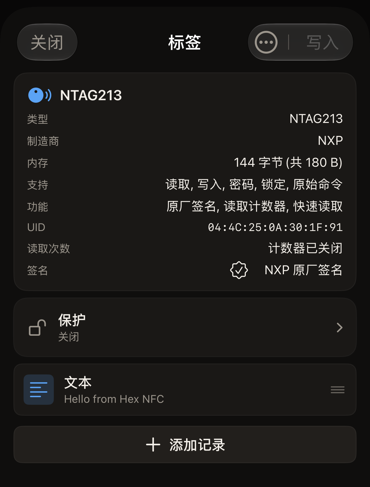

大约 5 分钟内，你将用 Hex NFC 读取一枚 NFC 标签，并在屏幕上和应用的扫描历史中查看其中的内容。你需要准备 iPhone 和一枚标签。

## 开始之前

- 从 [App Store](https://apps.apple.com/app/id6801457461) 将 Hex NFC 安装到运行 iOS 17 或更高版本的 iPhone 上。首次启动时不需要做任何设置，应用会直接打开 Hex NFC 主屏幕。[常见问题](faq.md)介绍了应用的费用，以及它可以在哪些 iPhone 上运行。
- 准备好一枚标签。贴纸、卡片或钥匙扣都可以。
- 空白标签也可以。应用会读取它，并显示其中没有内容。
- 读取标签不会改动标签上的任何内容。本页的操作都不会写入你的标签。

## 读取你的第一枚标签

:::::steps
::::step[打开扫描界面]
Hex NFC 打开后显示主屏幕，应用名称下方有四个图块：**扫描**、**创建**、**库**和**高级**。点按左上角的**扫描**图块。扫描界面随即打开并等待标签，界面上显示“将标签贴近 iPhone 顶部”。
::::

::::step[将标签贴近 iPhone]
将 iPhone 顶部平贴在标签上，保持不动。读取期间，iOS 会在屏幕底部显示它自己的面板，应用的文字仍显示在面板上方。扫描界面先显示“正在读取…”，然后显示“已检测到标签”。出现“已检测到标签”时，应用已经读完标签，你可以把 iPhone 移开。如果没有读取到标签，界面会显示“扫描失败”，并在下方说明原因。点按**重试**，然后将标签稳稳地贴近 iPhone 顶部。标签不应答时该怎么办，请参阅[标签无法扫描或写入时](troubleshooting.md)。
::::

::::step[查看应用读取到的内容]
在“已检测到标签”下方，应用会显示芯片名称，并统计读取到的内容。记录是标签上的一项内容，例如一个链接或一段文字。带有一条记录的标签会显示“找到 1 条记录”，没有记录的标签会显示“此标签上没有 NDEF 记录”。这个界面会停留大约一秒钟。芯片名称和标签的 UID 会在下一个界面上再次出现，所以这里不需要记住任何内容。其他读取结果请参阅[扫描标签](scan-a-tag.md)。
::::

::::step[打开一条记录]
「标签」界面会自动打开。顶部的卡片显示芯片名称，其中有一行 **UID**。卡片下方，每条记录占一行，显示记录的类型和内容预览。点按一行可查看完整的记录，然后点按**取消**返回。**取消**会关闭这条记录，不会向标签或应用写入任何内容。空白标签会在这些行的位置显示“空标签”，这表示读取已经完成，并不是失败。

:::figure[扫描 NTAG213 后，「标签」界面顶部的卡片中有 **UID** 行，标签上唯一的一条记录位于下方，显示为**文本**行。]

:::
::::

::::step[关闭标签]
点按**关闭**。「标签」界面会关闭，不写入任何内容，你会回到主屏幕。
::::
:::::

## 小结

现在，你可以读取手边的任何标签，并了解其中的内容。应用保存了这次扫描。在主屏幕上点按**库**，然后点按**历史**，也就是「库」界面顶部两个选项卡中的第二个。你的扫描位于列表顶部。置顶的扫描会一直保留，不受[查找以前扫描过的标签](scan-history.md)中所述上限的限制。打开保存的扫描会回到同一个「标签」界面，不需要再次贴近标签。

## 后续步骤

- 阅读[扫描标签](scan-a-tag.md)，了解每种扫描结果的含义，以及先要求输入密码的标签该如何处理。
- 阅读[查找以前扫描过的标签](scan-history.md)，了解如何重新打开、置顶和删除保存的扫描。
- 阅读[将链接写入标签](write-a-link.md)，了解如何将网址写入空白标签。
- 阅读[适用于 Hex NFC 的标签](tags-that-work.md)，了解应用能识别哪些芯片。
- 标签不应答时，请阅读[标签无法扫描或写入时](troubleshooting.md)。
