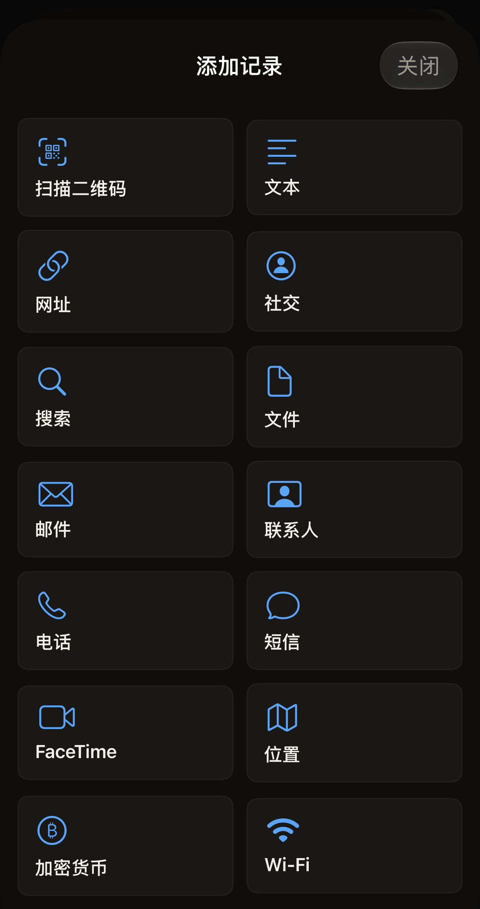
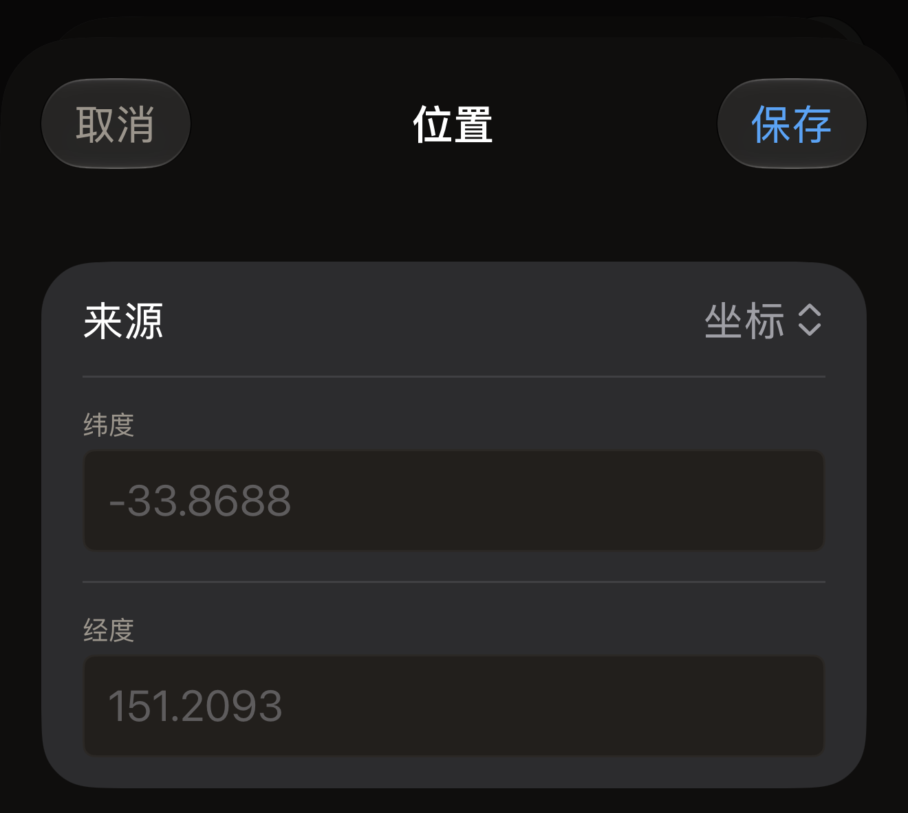

标签中存有一个记录列表，每条记录都有一种类型。用 iPhone 扫描一枚标签，或者在 Hex NFC 主屏幕上点按**创建**，从一个空的记录列表开始。然后在「标签」界面上点按**添加记录**。应用提供 13 种类型，[编辑标签的记录](edit-records.md)会逐步介绍添加方法。你选择的类型决定了记录编辑器显示哪些栏，也决定了其他手机以后读取这枚标签时看到什么。扫描的标签还可能包含另外五种类型，应用可以打开它们，但不提供添加，详见[可打开但不可添加的类型](#types-you-can-open-but-not-add)。

:::figure[**添加记录**提供 13 种记录类型，排在最前面的**扫描二维码**可将二维码转换为记录。]

:::

## 类型的作用

每种类型都是承载一种信息的格式。电话号码放在**电话**记录中，网络放在 **Wi-Fi** 记录中。应用会把你输入的内容转换为 NFC 标准为该格式定义的字节。请选择最贴近的类型，不要把电话号码放进**文本**记录：读取标签的手机是根据格式来处理的，而不是根据你的意图。

读取标签的手机会做什么，由那部手机决定。链接在任何地方都是链接，网络却不一样：正如 **Wi-Fi** 表单上所说，“iPhone 不会通过 NFC 自动连接,但 Android 读取设备可以。Hex NFC 按规范写入记录,任何读取设备都能识别。”

记录会占用空间，容量小的芯片会用完空间。每种芯片能存储多少内容，请参阅[适用于 Hex NFC 的标签](tags-that-work.md)。

## 文本和链接

:::table[用于文本、链接和查询的记录类型]
| 类型 | 需要填写的内容 | 写入标签的内容 |
| --- | --- | --- |
| **文本** | **文本**、**语言代码**、**编码** | 你输入的文字，带有你输入的语言代码标记，并以你选择的编码写入。 |
| **网址** | **网址** | 与你输入的完全相同的地址。常见的网址前缀以单个字节存储，因此记录占用的空间更小。 |
| **社交** | **平台**、**用户名** | 一个个人主页链接，由你选择的平台和你输入的用户名组成。 |
| **搜索** | **引擎**、**查询** | 一个对应你所选搜索引擎的搜索地址，其中带有你输入的词语。 |
| **文件** | **路径** | 一个文件地址。表单上是这样说明的：“以 file:// URL 形式存储。iOS 限制了它可以指向的目录。” |
:::

新的**文本**记录默认使用语言代码 en，这一栏自己的说明给出了应使用的格式：“ISO 639-1,例如 en、fr、ja”。**编码**有两个选项：**UTF-8** 和 **UTF-16**，新记录默认使用 **UTF-8**。

在大多数平台上，**用户名**是个人主页地址末尾的名称，输入时不要带前面的 @。有六个平台需要填写别的内容，因为它们的地址不是由用户名组成的。

- 对于 **Whatsapp**，请输入 wa.me 链接中所带的电话号码，即不带加号的完整国际号码。
- 对于 **Skype**，请输入 Skype 名称。
- 对于 **Steam**，请输入个人主页地址中的自定义网址。
- 对于 **Slack**，请输入其地址开头的工作区名称。
- 对于 **Facebook** 和 **Wechat**，请输入它们自己的链接中所带的内容，可能是名称，也可能是号码。

应用会把你输入的内容放进该平台的个人主页地址中，不会对地址做其他任何改动。

**引擎**包括 **Google**、**Google Images**、**Bing**、**Yandex**、**DuckDuckGo**、**YouTube** 和 **Wikipedia**。**平台**包括 **Facebook**、**Bluesky**、**X**、**Github**、**Instagram**、**Line**、**Linkedin**、**Medium**、**Pinterest**、**Skype**、**Slack**、**Snapchat**、**Soundcloud**、**Steam**、**Telegram**、**Threads**、**Tiktok**、**Twitch**、**Vk**、**Wechat**、**Whatsapp** 和 **Youtube**，屏幕上的拼写与这里完全相同。

## 联系人与消息

:::table[用于联系他人的记录类型]
| 类型 | 需要填写的内容 | 写入标签的内容 |
| --- | --- | --- |
| **邮件** | **收件人**、**抄送**、**密送**、**主题**、**正文** | 一个邮件地址，带有收件人、主题行和邮件内容。 |
| **联系人** | **身份**下的**全名**和**组织**，然后是**联系方式**下的**电话**、**电子邮件**和**网站** | 一张联系人名片，读取它的手机可以将其添加到通讯录中。 |
| **电话** | **电话号码** | 一个电话地址。读取它的手机会提示拨打这个号码。 |
| **短信** | **收件人**、**消息** | 一个短信地址，包含号码和要发送的文字。 |
| **FaceTime** | **目标**、**模式** | 一个 FaceTime 地址，按你的选择进行视频或语音通话。 |
:::

其中有六栏可以填写多个条目：**收件人**、**抄送**、**密送**、**电话**、**电子邮件**和**网站**都按逗号拆分，所以**收件人**和**电话**会显示“以逗号分隔”的提示。如果**组织**留空，名片中就不会包含它。

## 位置、付款和网络

:::table[用于位置、付款或网络的记录类型]
| 类型 | 需要填写的内容 | 写入标签的内容 |
| --- | --- | --- |
| **位置** | **来源**，然后是**纬度**和**经度**，或者**地图网址** | 一个地图地址：一对坐标，或你粘贴的地图链接。 |
| **加密货币** | **网络**、**地址**、**金额**、**消息** | 你所选网络上的一个付款地址。**金额**和**消息**留空时不会写入。 |
| **Wi-Fi** | **网络名称(SSID)**、**密码**、**认证**、**加密**、**隐藏网络** | 一条网络记录，包含名称、密码和你选择的安全设置。 |
:::

**来源**决定了**位置**表单的其余部分。它包括**坐标**、**Apple 地图网址**和 **Google 地图网址**。选择**坐标**时显示**纬度**和**经度**。请分别以十进制数输入，例如 `-33.8688` 和 `151.2093`。也可以用逗号作小数点，`48,8566` 会被读作 `48.8566`。另外两种来源都改为显示**地图网址**。地址需要你自己提供：从地图应用或你找到该地点的浏览器中复制链接，然后粘贴到这一栏。标签得到的链接与你粘贴的完全相同。你选择了这两种中的哪一种，根本不会写入标签。请选择能说明链接出处的那一种。应用从不读取 iPhone 所在的位置。每个位置都是你输入或粘贴的，或者来自二维码或你扫描过的标签。

:::figure[**来源**设为**坐标**时，表单显示**纬度**和**经度**，在你输入之前，两栏中各有一个灰色的示例值。]

:::

**位置**记录需要同时有纬度和经度，或者有一个地图网址。在填好之前，表单会显示“请输入纬度和经度，或地图网址。在此之前，这条记录无法写入标签。”「标签」界面上这条记录所在的行也会显示“无位置”。如果你添加了**位置**记录，然后点按**取消**离开，它会以这种状态留在列表中。列表中有这样的记录时写入标签，写入会在 iOS 扫描面板打开之前停止，并显示“有一条位置记录缺少坐标或地图网址。标签上没有写入任何内容。”请填写这条记录或将其删除，然后再次写入。**另存为预设…**也会同样拦下：列表中有这样的记录时，**保存**一直呈灰色，保存面板会说明原因。预设一旦保存就无法更改，因此在旧版本应用中保存的、带有空白**位置**记录的预设，每次写入都会被拒绝。请在「标签」界面上重新创建它的记录，另存为新的预设，然后删除旧的预设。

**网络**包括 **Bitcoin**、**Ethereum**、**Monero**、**Litecoin**、**Dogecoin** 和 **Solana**。**金额**是一个普通文本栏，没有提示，也不做任何检查。应用会将你输入的内容原样复制到付款链接中。请按照你所用钱包的写法填写数字。在任何人付款之前，请先在该钱包中核对一遍金额。

在 **Wi-Fi** 表单上，**认证**默认是 **WPA2 Personal**，**加密**默认是 **AES**，大多数家用路由器使用的就是这一组设置。**认证**还包括 **WPA3 Personal**、**WPA Personal**、**WEP** 和**开放**。**加密**还包括 **TKIP**、**TKIP + AES**、**WEP** 和**无**。请选择与路由器自身设置页面上一致的组合。

:::warning[Wi-Fi 记录以可读形式存储密码]
每部读取这枚标签的手机都会同时读到网络密码。只有在你不介意任何人读取的标签上，才写入 **Wi-Fi** 记录。
:::

## 可打开但不可添加的类型 {#types-you-can-open-but-not-add}

扫描的标签、预设或扫描历史中的条目可能包含**添加记录**不提供的五种类型：**应用链接**、**蓝牙**、**数据**、**快捷指令**和**原始**。它们都没有自己的表单。点按其中一种会打开一个文本编辑器，以 JSON 形式显示这条记录，上方有一条说明：「此类记录以 JSON 编辑。文本不是有效记录时，“保存”会保留最后一个有效版本。」

:::table[这五种类型写入标签的内容]
| 类型 | 写入标签的内容 |
| --- | --- |
| **应用链接** | 一个 App Store 地址，以链接形式写入。 |
| **蓝牙** | 一条配对记录，包含设备地址和设备名称。 |
| **数据** | 记录的字节，并标有其媒体类型。 |
| **快捷指令** | 一个按名称运行快捷指令的地址，并附带记录提供给它的输入。 |
| **原始** | 记录的确切字节，原样写回。 |
:::

编辑器打开时，记录已经完整地写在里面。已经有值的键显示在屏幕上，你可以直接修改这些值。还没有值的键不会出现。下表中的可选键在你输入之前都不会出现，输入时拼写必须与这里列出的完全一致。`id` 和 `type` 请保持应用写入时的样子。其余的键如下：

:::table[每种仅限 JSON 的类型所带的键]
| 类型 | 需要填写的键 |
| --- | --- |
| **应用链接** | `appStoreURL`，如有需要，再加上 `universalLink` 和 `displayName` |
| **蓝牙** | `deviceMAC`，如有需要，再加上 `deviceName` |
| **数据** | `mimeType`，以及 base64 格式的 `payload` |
| **快捷指令** | `shortcutName`，如果快捷指令需要输入，再加上 `input` |
| **原始** | `tnf`（取下方列表中的数字），然后是 base64 格式的 `typeBytes`、`idBytes` 和 `payload` |
:::

一条以纯文本形式存储单词 Hello 的**数据**记录如下：

```text title="JSON 编辑器中的一条数据记录"
{
  "id" : "9E2B1C64-6A2F-4D0E-9A52-0B7F1C3D8E44",
  "mimeType" : "text/plain",
  "payload" : "SGVsbG8=",
  "type" : "data"
}
```

这个 `payload` 背后没有转换器。它的值必须是你在别处生成的 base64。直接粘贴原始文本不会对其编码。不是有效 base64 的 `payload` 会导致整条记录无法读取。下面的说明介绍了这种情况。

当应用读到无法归类的记录时，就会将其视为**原始**类型。对这类记录，通常的做法是原样写回。如果要修改，先从 `tnf` 开始：NDEF 标准用这个数字说明 `typeBytes` 中存放的是哪一类名称。它的值是以下数字之一。

- 0 表示空记录。
- 1 表示 NFC Forum 自己列表中的名称。
- 2 表示媒体类型。
- 3 表示绝对地址。
- 4 表示由厂商定义的名称。
- 5 表示未知。
- 6 表示被拆分记录的后续部分。

`typeBytes`、`idBytes` 和 `payload` 都是 base64 格式，`idBytes` 通常为空。

```text title="一条使用厂商自定义类型的原始记录"
{
  "id" : "3F7A9D21-4C88-4B0A-BE13-52C0A7E6D915",
  "idBytes" : "",
  "payload" : "SGVsbG8=",
  "tnf" : 4,
  "typeBytes" : "ZXhhbXBsZS5jb206bm90ZQ=="
}
```

:::note[编辑器无法读取的文本会被忽略]
一旦你的文本能读作一条记录，编辑器就会立即应用它。在此之前，记录会保留原来的值，也不会出现任何提示。编辑器里同样没有任何确认，所以点按**保存**后请检查一下。「标签」界面上这条记录所在的行有第二行文字，取自记录本身。

- 类型为**数据**时，是媒体类型。
- 类型为**快捷指令**时，是快捷指令名称。
- 类型为**应用链接**时，是 App Store 地址。
- 类型为**蓝牙**时，是设备名称或地址。
- 类型为**原始**时，是有效载荷的前几个字节。

如果第二行文字仍和之前一样，说明你的文本始终没有成为一条记录。
:::

## 保存、放弃和删除记录

**保存**会保留你的修改，**取消**会放弃修改。**删除记录**会将记录从列表中移除并关闭编辑器，事先不会询问。到那时**取消**已经不在了，因此以这种方式删除的记录只能重新添加。这三者都只作用于应用中保存的副本，从不作用于标签。只有在你写入时标签才会改变，详见[编辑标签的记录](edit-records.md)。

每条记录都由你输入的内容构成。记录编辑器不会读取你的通讯录、你的位置或你身边的蓝牙设备。[隐私与你的数据](privacy.md)说明了应用会保存哪些内容。

## 扫描的标签会显示为什么类型

应用会把读到的内容归入它所知道的最接近的类型。电话、短信、邮件、FaceTime、地图、付款、快捷指令或文件地址会以相应的类型打开，其他任何链接都以**网址**记录打开。联系人名片、网络记录和配对记录各自恢复为原来的类型。其他媒体类型会成为**数据**记录，剩下的所有内容都会成为**原始**记录，写回时逐字节保持不变。

## 另请参阅

- [编辑标签的记录](edit-records.md)
- [将链接写入标签](write-a-link.md)
- [将标签另存为预设](presets.md)
- [芯片支持矩阵](../developer/chip-support-matrix.md)
