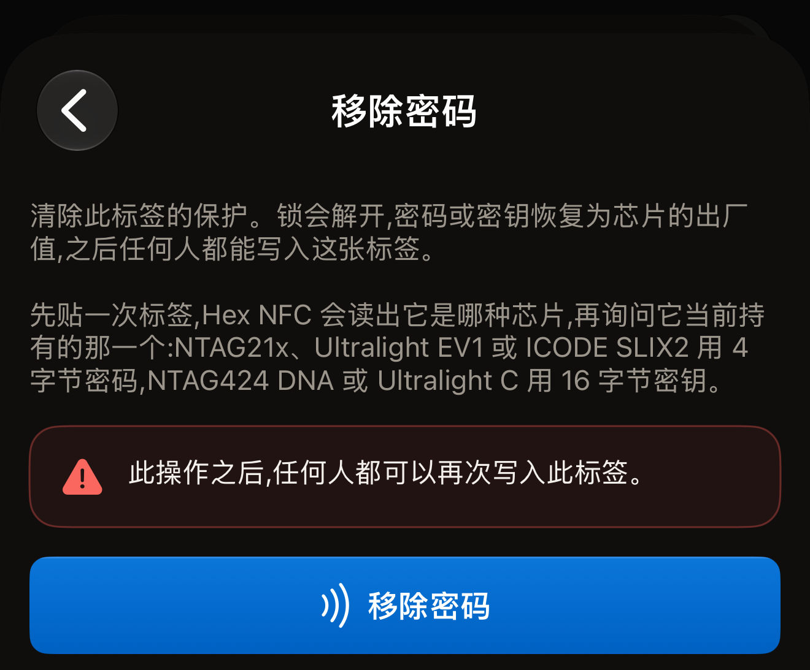
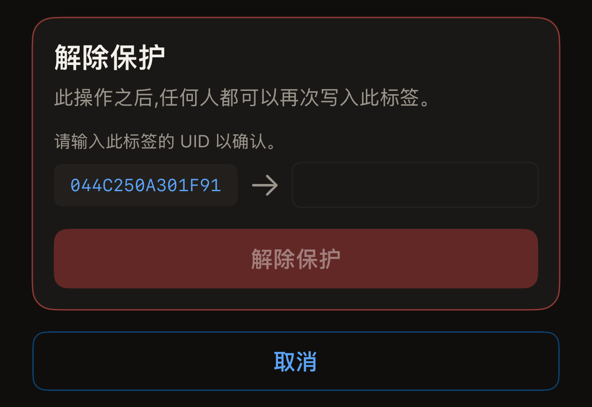
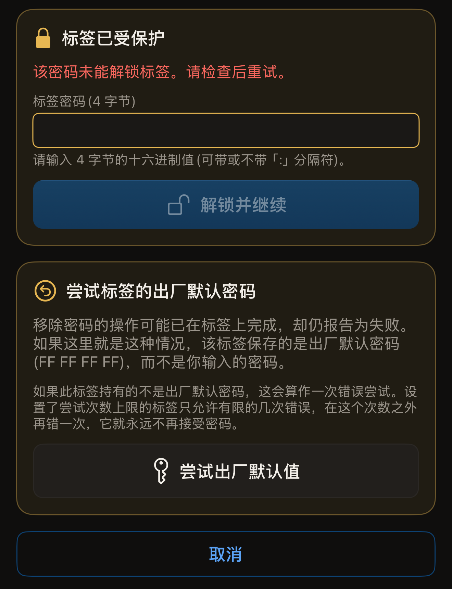

你给标签设置的密码可以再移除，只要你还能发送标签当前持有的密码。密码移除后，任何人都可以读写这枚标签，它的密码或密钥也会恢复为芯片的出厂默认值。

开始之前，在 iPhone 上打开 Hex NFC 并扫描标签，让它显示在「标签」界面上（请参阅[扫描标签](scan-a-tag.md)）。准备好标签当前持有的密码。该界面顶部卡片的第一行是芯片名称，位于标签 UID 的上方。这个名称决定了移除时要求输入哪种密码或密钥。下面两种方式都没有提到的芯片上，没有 Hex NFC 可以移除的密码，因为应用从不在这类芯片上设置密码。

## 在「操作」界面中移除密码

这种方式适用于应用可以保护的所有芯片。在第一次贴合之前，它不需要你输入任何内容。这次贴合会读出标签是哪种芯片，随后界面会要求输入标签当前持有的密码或密钥：NTAG21x 系列芯片（NTAG213、NTAG213 TT、NTAG215、NTAG216）、MIFARE Ultralight EV1 或 ICODE SLIX2 为 4 字节密码，NTAG424 DNA 或 MIFARE Ultralight C 为 16 字节密钥。NTAG 210µ 没有可移除的密码。[芯片支持矩阵](../developer/chip-support-matrix.md)列出了每种芯片支持的内容。

:::::steps
::::step[打开「操作」界面]
在**标签**界面上，打开右上角的菜单，然后点按**操作…**。
::::

::::step[打开「移除密码」]
点按**移除密码**。
::::

::::step[开始移除]
点按**移除密码**。按钮上方的警告说明了移除的代价：“此操作之后,任何人都可以再次写入此标签。”

:::figure[要点按的**移除密码**按钮位于界面底部、警告下方。]

:::
::::

::::step[将标签贴近 iPhone 顶部]
应用读取标签的 UID 后结束这次贴合，以便你输入。
::::

::::step[输入标签当前的密码或密钥]
标题为“标签已受保护”的卡片会要求输入标签当前持有的密码或密钥。在**标签密码(4 字节)**栏中以 8 个十六进制字符输入密码。在 NTAG424 DNA 上，这个栏是**标签密钥(AES,16 字节)**；在 MIFARE Ultralight C 上，则是**标签密钥(3DES,16 字节)**。分隔符会被忽略，因此 `FF FF FF FF` 和 `FFFFFFFF` 是同一个值。
::::

::::step[确认标签]
界面会在“请输入此标签的 UID 以确认。”下方、栏的旁边显示标签的 UID。将这些字符输入栏中，不要加分隔符。大小写均可。点按**移除密码**，然后再次将标签贴近 iPhone。
::::
:::::

::include[two-tap-confirmation]

第二次贴合完成后，界面会显示“密码已移除。”标签现已不受保护，任何手机都可以重写它的记录。如果标签之前还要求先提供密码才显示内容，这项读保护也会随写保护一起解除。

## 在「标签」界面中解除保护

在应用可以保护的任何芯片上，也可以在写入时一并解除保护，这需要标签当前持有的密钥或密码。这次写入会把**标签**界面上列出的记录重新写回标签。扫描之后，这个列表就是标签现有的内容，所以除非你自己编辑过列表，标签的内容都会保留下来。

:::::steps
::::step[打开「保护」]
在**标签**界面上，点按**保护**。
::::

::::step[关闭保护]
在 NTAG424 DNA 或 MIFARE Ultralight C 标签上，关闭**用密钥保护此标签**；在使用密码的芯片（NTAG21x、MIFARE Ultralight EV1 或 ICODE SLIX2）上，关闭**用密码保护此标签**。开关下方的说明会告诉你，下一次写入将同时解除读保护和写保护，并把密码或密钥恢复为出厂默认值。
::::

::::step[保留更改]
点按**完成**。
::::

::::step[写入标签]
在**标签**界面上，点按**写入**，然后将标签贴近 iPhone 顶部。应用会读取标签的 UID，并要求你把它输入回来。
::::

::::step[确认标签]
输入栏旁边显示的 UID，不加分隔符，大小写均可，然后点按**解除保护**。再次将标签贴近 iPhone，完成更改。

:::figure[**解除保护**卡片显示应用读到的 UID，并用箭头指向你要输入它的空栏。]

:::
::::
:::::

写入时，应用会发送它已经为该标签保存的密钥或密码，也就是你在**保护**卡片上输入的那个，或者你保护标签时使用的那个。如果应用没有为该标签保存任何密码或密钥，写入会停在“标签已受保护”，要求你提供。要求输入的栏取决于芯片：

- 在 NTAG424 DNA 上，在**标签密钥(AES,16 字节)**栏中输入。
- 在 MIFARE Ultralight C 上，在**标签密钥(3DES,16 字节)**栏中输入。
- 在 NTAG21x、MIFARE Ultralight EV1 或 ICODE SLIX2 上，在**标签密码(4 字节)**栏中输入。

然后点按**解锁并继续**。由于应用已经读取了标签的 UID，不会多出一次贴合。接下来是确认卡片。输入 UID，点按**解除保护**，然后再次贴近标签。

## 标签拒绝密码时

在 NTAG21x 或 MIFARE Ultralight EV1 上，一次贴合只发送一个密码。标签拒绝后，在这次贴合的剩余时间里都会停止应答。应用绝不会在同一次贴合中尝试第二个密码。

标签拒绝密码后，“标签已受保护”卡片会再次出现，并显示“该密码未能解锁标签。请检查后重试。”卡片中的栏是空的，所以除非你重新输入，被拒绝的密码不会再次发送。输入密码，点按**解锁并继续**，然后再次贴近标签。**取消**会让界面回到初始状态。

如果移除因其他原因失败，界面会提供**输入其他密码**。它会让界面回到初始状态，下一次操作会在空栏中再次要求输入密码。

如果标签拒绝了你输入的密码，而这个密码又不是 `FF FF FF FF`，应用会提供一个具体的尝试办法。**移除密码**界面的失败提示下方会出现一张标题为“尝试标签的出厂默认密码”的卡片。移除可能已经在标签上完成，却仍然报告失败，这时标签持有的是 `FF FF FF FF`，而不是你输入的密码。每一枚 NTAG21x 和 MIFARE Ultralight EV1 出厂时都是这个值。点按**尝试出厂默认值**，就会在下一次贴合时发送它。在这次贴合进行之前，界面会说明将发送哪个密码。它写着：“下一次贴合标签时将发送出厂默认密码 (FF FF FF FF)，而不是你输入的密码。”

:::figure[密码被拒绝后，出厂默认密码卡片位于“标签已受保护”卡片下方，底部是**尝试出厂默认值**。]

:::

:::warning
如果标签持有的不是出厂默认密码，这次贴合就算作一次密码错误。设置了尝试次数上限的标签只允许有限次数的密码错误，超出后再错一次，它就会永远不再接受密码。请参阅[限制密码错误次数](attempt-limit.md)。
:::

如果出厂默认密码打开了标签，应用会在操作完成后告诉你。提示为：“打开这枚标签的是出厂默认密码，说明先前的移除其实已经生效。你为这枚标签保存的密码并不是它当前持有的密码。”

## 移除未完成时

贴合两次，就意味着标签有两次提前移开的可能。应用在报告任何结果之前都会回读标签的保护状态，所以提示会说明标签现在的状态：

- 无论出现在哪里，“密码已移除。”都表示成功，即使所在界面的其他部分在报告失败也是如此。回读结果显示保护已经解除。
- “此标签仍受保护。没有任何内容丢失：请再次将它贴近手机，完成密码的移除。”表示回读结果显示保护仍然开启。请用同一个密码再执行一次移除。
- “无法确认密码是否已移除。请再次将标签贴近手机进行检查。”表示应用还没来得及读取保护状态，标签就离开了感应范围。请再执行一次移除，以弄清标签目前的状态。

如果你手上没有任何密码能打开这枚标签，它受保护的内存将保持原样。[标签保护](tag-protection.md)说明了丢失的密码为何无法恢复。

## 另请参阅

- [标签保护](tag-protection.md)
- [用密码保护标签](protect-a-tag.md)
- [限制密码错误次数](attempt-limit.md)
- [标签无法扫描或写入时](troubleshooting.md)
