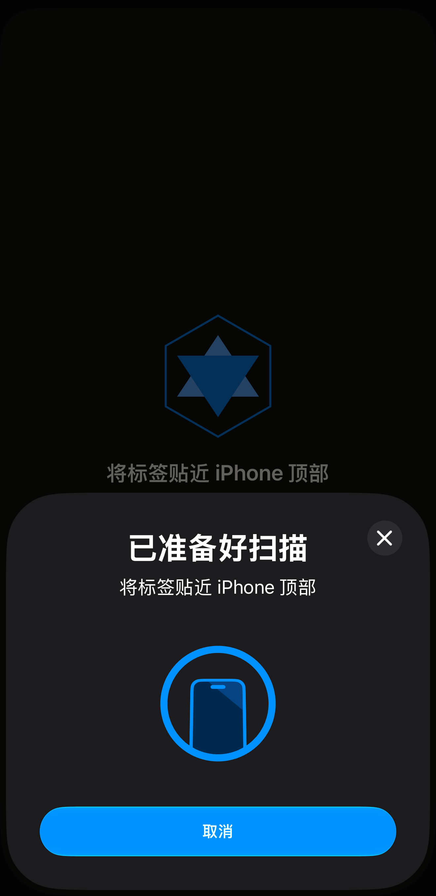
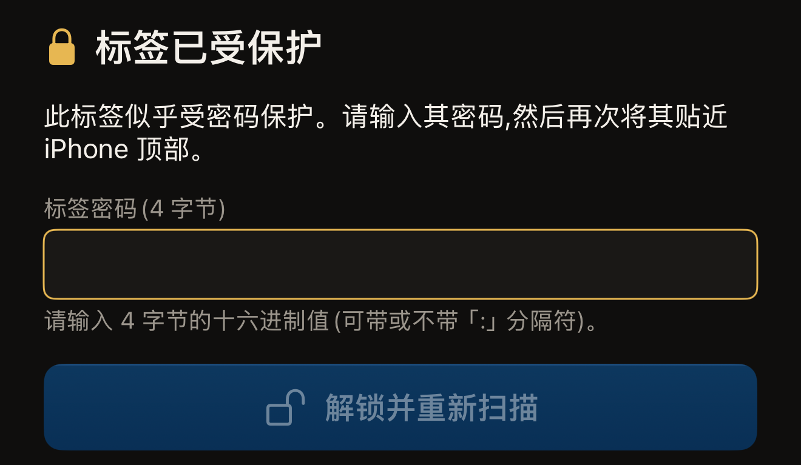
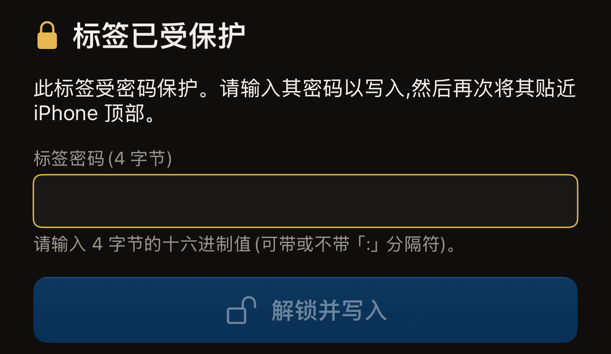

Hex NFC 贴合一次就能读取标签。点按**扫描**，将标签贴近 iPhone 顶部，应用就会显示它找到了哪种芯片，以及标签中有什么内容。扫描只会读取，因此标签上的内容不会改变。

标签也可以设置为必须先提供密码才能读取。以这种方式保护的标签，在收到密码之前会拒绝读取。发送密码需要贴合两次，而不是一次。本页后半部分会介绍这种情况。大多数受保护的标签只有写保护，这类标签和其他标签一样，贴合一次即可扫描。如果你从未扫描过标签，[读取你的第一枚标签](quick-start.md)会从头介绍同样的贴合过程。

## 扫描标签

:::::steps
::::step[打开扫描界面]
打开 Hex NFC，在它的主屏幕上点按**扫描**。扫描界面随即打开，并显示“将标签贴近 iPhone 顶部”。

:::figure[应用等待标签时，它自己的提示行显示在 iOS 扫描面板上方，点按面板上的取消可停止扫描。]

:::
::::

::::step[将标签贴近 iPhone 顶部]
将 iPhone 顶部贴在标签上，保持不动。读取标签期间，界面显示“正在读取…”。
::::

::::step[查看应用读取到的内容]
界面上出现带勾号的“已检测到标签”，下方是芯片名称。再往下，应用会说明它读取到了什么。“找到 1 条记录”这一行给出标签上的记录数。“此标签上没有 NDEF 记录”表示标签已格式化，但其中没有内容。最后一行是标签的 UID。
::::
:::::

结果会停留大约一秒钟，然后应用会打开**标签**界面并列出记录，你可以在那里修改记录或再次写入。结果中的信息在那里一样不少。芯片名称是标签信息卡片的标题，记录是卡片下方的列表。UID 是这张卡片上的一行，随时点按都可以复制。每次扫描也会保存到你的扫描历史中。请参阅[查找以前扫描过的标签](scan-history.md)和[编辑标签的记录](edit-records.md)。

如果想在读取标签之前停止，请点按 iOS 扫描面板上的取消。扫描界面会关闭，你会回到主屏幕。如果没有标签贴近 iPhone，iOS 面板会在大约一分钟后自动关闭，扫描界面会显示“未找到标签”，下方有**取消**和**重试**。

有些标签会从扫描界面进入其他流程。日本的交通卡会打开它自己的只读结果，详见[读取交通卡](transit-cards.md)。电子护照会先要求输入照片页上的信息，详见[读取护照](passports.md)。NFC 健康设备（例如胰岛素笔）会打开只读的**健康设备**界面，并且不会被保存，详见[健康设备](tags-that-work.md#health-devices)。受保护的标签会要求输入密码，这是本页接下来要介绍的任务。

如果结果显示“此标签尚未格式化”，那么在标签格式化之前，你写入的任何内容都无法读取。[擦除或格式化标签](erase-or-format.md)介绍了具体做法。

## 解锁受保护的标签 {#unlock-a-protected-tag}

需要密码才能读取的标签会让扫描停下来。扫描界面会显示“标签已受保护”，下方是这句话：“此标签似乎受密码保护。请输入其密码,然后再次将其贴近 iPhone 顶部。”再往下是密码栏、**解锁并重新扫描**，以及包含**取消**和**重试**的一行按钮。密码属于标签，而不属于某个账户，只有设置密码的人才知道它。产生这种状态的设置是**读取时也需要密码**，详见[用密码保护标签](protect-a-tag.md)。

:::::steps
::::step[输入标签的密码]
在**标签密码(4 字节)**中，以十六进制字符（0 到 9 和 A 到 F）输入密码。4 字节的密码共 8 个字符：可以输入 `A1B2C3D4`，也可以输入 `A1:B2:C3:D4`，因为字节之间的冒号可有可无，也不计入长度。输入的长度正确后，这一栏下方的说明会显示“有效”。

:::figure[受保护的标签会让扫描停在**标签密码(4 字节)**，在输入的长度正确之前，**解锁并重新扫描**一直呈灰色。]

:::

在 NTAG424 DNA 上，这一栏显示的是**标签密钥(AES,16 字节)**。在 MIFARE Ultralight C 上，显示的是**标签密钥(3DES,16 字节)**。这两种芯片要用密钥而不是密码打开。这两种密钥都是 16 字节，也就是 32 个字符。
::::

::::step[开始第二次贴合]
点按**解锁并重新扫描**。在你输入的内容符合该芯片要求的长度之前，这个按钮一直呈灰色。
::::

::::step[再次将标签贴近 iPhone 顶部]
应用会发送密码，然后读取标签，并像对待其他标签一样显示“已检测到标签”。
::::
:::::

如果标签拒绝了密码，界面会回到“标签已受保护”，提示换成“该密码未能解锁标签。请检查后重试。”在 NTAG424 DNA 或 MIFARE Ultralight C 上，提示则是“该密钥未能解锁标签。请检查后重试。”改正输入后，点按**解锁并重新扫描**，再贴合一次。密码被拒绝后，芯片在这次贴合的剩余时间里都不再应答。每次尝试都是一次新的贴合，这是有意这样设计的。如果想回到不使用密码的普通读取，请点按**重试**。**取消**的作用不同：它会关闭扫描界面而不读取标签，你输入的内容也会被丢弃。两者都不会改动标签。

:::warning[密码被拒绝可能会消耗一次尝试机会]
标签可以设置为只接受一定次数的错误密码，超过之后就永远不再接受密码。如果标签报告了这种上限，应用会改为显示拒绝时的原文提示，而不是上面的建议。与其再试一次，不如先重新核对密码。请参阅[限制密码错误次数](attempt-limit.md)。
:::

## 写入前解锁受保护的标签

写入从**标签**界面开始。受保护的标签要通过上面的解锁才能进入**标签**界面。先完成那次扫描，应用就会像对待其他标签一样打开**标签**界面。有两种途径可以跳过这次读取。在**库**中，**历史**选项卡列出你以前扫描过的标签，点按其中一行即可在**标签**界面中重新打开那枚标签。在**预设**选项卡上，将一个预设从左向右轻扫会显示**写入**，它会直接打开写入界面，准备写入这个预设的记录。

在**标签**界面中，点按工具栏中的**写入**，写入界面随即打开。[将链接写入标签](write-a-link.md)完整介绍了写入的全过程；下面介绍的是受保护标签额外增加的步骤。

即使是刚刚解锁过的标签，写入界面也会再次要求输入密码。每次贴合都是一个单独的会话，应用不会在会话之间保留密码。再输入一次密码是正常的，并不表示解锁失败。从头算起，受保护的标签需要贴合三次：被拒绝的那次扫描、打开**标签**界面的解锁扫描，以及写入。界面会显示“标签已受保护”，然后要求输入密码：“此标签受密码保护。请输入其密码以写入,然后再次将其贴近 iPhone 顶部。”

:::::steps
::::step[在写入界面输入密码]
在**标签密码(4 字节)**中输入标签的密码，也就是扫描时要求输入的那 8 个十六进制字符。在使用密钥的那两种芯片上，这一栏要求的是密钥而不是密码，密钥为 32 个字符。

:::figure[在写入界面上，提示要求输入密码以便写入，按钮显示**解锁并写入**，而不是**解锁并重新扫描**。]

:::
::::

::::step[开始写入的第二次贴合]
点按**解锁并写入**。如果这次写入还会更改标签的保护，按钮会显示**解锁并继续**。之后，应用会在写入之前显示标签的 UID，并在“请输入此标签的 UID 以确认。”下方要求你输入它。请参阅[用密码保护标签](protect-a-tag.md)。
::::

::::step[贴近标签以写入]
再次将标签贴近 iPhone 顶部。应用会先发送密码，然后写入。
::::
:::::

这里被拒绝时，界面同样会显示“该密码未能解锁标签。请检查后重试。”处理方法也一样：检查你输入的内容，然后再次贴近标签。

扫描可能以“扫描失败”结束，你以为是空白的标签也可能要求输入密码。无论哪种情况，请按照[标签无法扫描或写入时](troubleshooting.md)逐项排查。
