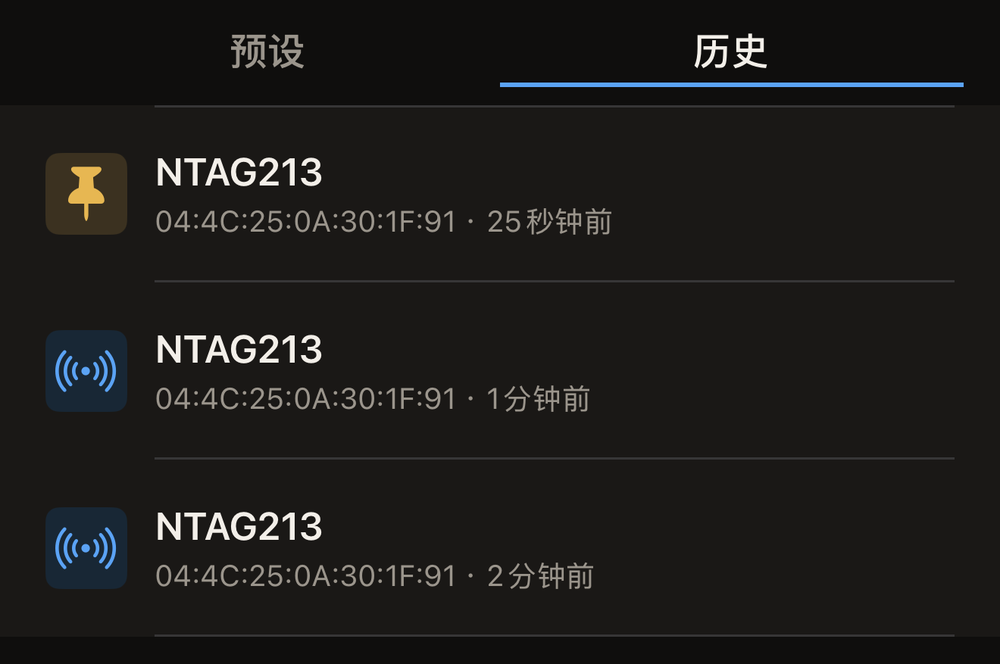

Hex NFC 会保留它读取过的标签的副本，因此即使标签不在身边，你也能再次打开以前的扫描。最近的扫描保存在 iPhone 上的资料库中，最新的排在最前面。把想保留的扫描置顶即可。

## 打开以前的扫描

你需要一枚已经读取过的标签；在你扫描第一枚标签之前，**历史**是空的。请参阅[扫描标签](scan-a-tag.md)。

:::::steps
::::step[打开 Hex NFC]
应用打开后显示 Hex NFC 主屏幕，上面有**扫描**、**创建**、**库**和**高级**图块。
::::

::::step[打开「库」]
点按**库**。「库」界面打开后显示**预设**。
::::

::::step[转到扫描历史]
在「库」界面顶部，点按**预设**右侧的**历史**。每一行以芯片名称开头，下方是标签的 UID 和读取至今的时间。

:::figure[每一行先显示芯片名称，再显示标签的 UID 和读取至今的时间；已置顶的扫描以图钉代替图标。]

:::
::::

::::step[打开扫描]
点按所需的扫描。「库」界面随即关闭，该扫描在「标签」界面中打开，其中包含产生这次扫描的那次贴合所读到的记录和芯片详情。
::::
:::::

交通卡则会在「交通卡」界面中以只读方式打开，与你读取这张卡时的打开方式相同。护照的读取结果从不保存，因此此列表中不会出现护照。请参阅[读取护照](passports.md)。健康设备同样从不保存。

## 置顶想保留的扫描

列表最多保存 50 次扫描。列表已满时，如果有新的扫描进来，最早的未置顶扫描会从末尾移除。无论列表多短，未置顶的扫描在产生它的那次读取 90 天后也会被移除。如果重新扫描后并入了已有的某一行，就算作一次新的读取，90 天重新计算。已置顶的扫描不受这两条规则约束，会一直保留，直到你将其删除。

扫描按从新到旧排列，界面上也没有搜索功能，因此请将以后还想找到的扫描置顶。

- 要置顶扫描，请在**历史**中向右轻扫该扫描，然后点按**置顶**。

已置顶的扫描在所在行的左侧显示图钉，代替通常的图标。它保持在列表中原来的位置，不会移到最上方。对已置顶的扫描执行同样的轻扫操作，按钮会显示为**取消置顶**；取消置顶后，该扫描重新计入 50 次的上限。

## 删除扫描

- 要删除扫描，请在**历史**中向左轻扫该扫描，然后点按**删除**。一直轻扫到底会立即删除该扫描。

:::warning
点按**删除**的那一刻，扫描就会被删除。不会要求你确认，也无法恢复，不过再次读取该标签会产生一次新的扫描。
:::

## 历史中保存的内容

在你读取任何标签之前，**历史**显示“没有扫描历史”，下方一行是“这里显示最近扫描的 50 个标签。置顶即可保留。”

- 再次读取同一枚标签时，如果标签没有任何变化，已有的扫描会移回列表最上方，不会出现第二行。如果芯片详情、记录或标签的密码保护有任何不同，则会新增一行。
- 扫描保存在本机上。只有在你打开 **iCloud 同步**后，扫描才会进入你的 iCloud 账户；该设置默认关闭。请参阅[隐私与你的数据](privacy.md)。

## 另请参阅

- [扫描标签](scan-a-tag.md)
- [编辑标签的记录](edit-records.md)
- [将标签另存为预设](presets.md)
