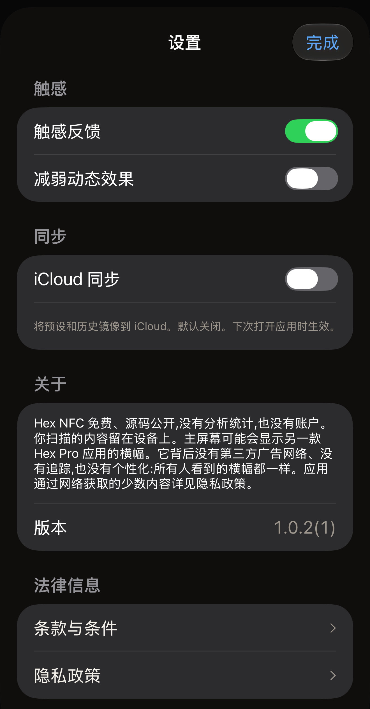

Hex NFC 有三项设置，它们与应用的版本号、发送反馈或为应用评分的入口，以及法律文件位于同一个界面。在 Hex NFC 主屏幕上，点按右上角的齿轮按钮；按钮上没有文字，VoiceOver 将它读作**设置**。打开的面板标题为**设置**。下面各组的顺序与界面上的显示顺序一致。

:::figure[**设置**面板打开时显示**触感**和**同步**，所有开关均为默认状态。]

:::

## 触感

:::table[触感设置]
| 设置项 | 作用 | 默认值 |
| :--- | :--- | :--- |
| **触感反馈** | 在扫描、写入以及应用设定的其他时刻让 iPhone 振动。关闭后，这些振动会立即停止。 | 打开 |
| **减弱动态效果** | 减少应用的动画。:more[只要这个开关或 iPhone 自身的「减弱动态效果」设置处于打开状态，应用就会减弱动态效果，因此关闭这个开关不会撤销系统设置。] | 关闭 |
:::

当 iPhone 自身的「减弱动态效果」处于打开状态时，该行下方会显示一行文字：“系统的「减弱动态效果」已开启:动画已降到最低。”

## 同步

:::table[同步设置]
| 设置项 | 作用 | 默认值 |
| :--- | :--- | :--- |
| **iCloud 同步** | 将你的预设和扫描历史镜像到你的 iCloud 账户。标签密码从不镜像，它们保存在设置这些密码的那台 iPhone 的钥匙串中。 | 关闭 |
:::

Hex NFC 只在启动时构建一次资料库，因此打开或关闭 **iCloud 同步**后，在你关闭并重新打开应用之前不会有任何变化。该行下方的文字也说明了这一点。这里的关闭是指退出应用。回到 iPhone 主屏幕后，Hex NFC 仍在运行，你拨动的开关依然不起作用。

### 打开 iCloud 同步 {#turn-on-icloud-sync}

::::steps
:::step[打开设置]
在 Hex NFC 的主屏幕上，点按右上角的齿轮按钮。
:::

:::step[打开 iCloud 同步]
打开 **iCloud 同步**。开关会移动，但其他内容暂时都不会变化。
:::

:::step[关闭 Hex NFC 并重新打开]
按照[关闭并重新打开应用](#close-and-reopen-the-app)操作。应用启动时会重建资料库，这一次同步已在运行。
:::

:::step[检查是否有警告]
再次点按齿轮按钮，查看 **iCloud 同步**下方。那里的说明文字为“将预设和历史镜像到 iCloud。默认关闭。下次打开应用时生效。”如果后面还有第二段文字，说明同步没有启动；请参阅[同步未启动时](#when-sync-does-not-start)。
:::
::::

### 关闭并重新打开应用 {#close-and-reopen-the-app}

::::steps
:::step[关闭 Hex NFC]
从屏幕底部边缘向上轻扫并停顿，直到出现已打开的应用。在带有主屏幕按钮的 iPhone 上，改为连按两次主屏幕按钮。然后在 Hex NFC 卡片上向上轻扫，卡片随即离开屏幕。
:::

:::step[再次打开 Hex NFC]
点按 Hex NFC 图标。应用启动时会重建资料库，并采用你关闭应用时 **iCloud 同步**的设置。
:::
::::

再次关闭 **iCloud 同步**同样需要关闭并重新打开应用。无论哪种情况，你的预设和历史都保留在本机上。Hex NFC 不会删除 iCloud 中已有的内容。登录同一账户的另一台 iPhone 会保留它已收到的所有内容。停止的只是从本机传出的新更改。

### 同步未启动时 {#when-sync-does-not-start}

如果开关已打开，但应用启动时无法连接 iCloud，同步就不会启动。该行下方会出现第二行文字：“同步未在运行。你的资料库已安全保存在本机，但 App 启动时 iCloud 不可用。请确认已登录 iCloud，然后重新打开 App。”你的预设和历史仍在 iPhone 上，只是镜像停止了。

出现这行文字的原因有三种：

- iPhone 未登录 iCloud。
- 该账户的 iCloud 储存空间已用完。
- Hex NFC 启动时 iPhone 没有网络连接。

请按顺序逐一排查。

::::steps
:::step[检查 iCloud 账户]
在 iPhone 上打开“设置”应用，点按顶部你的名字。如果系统要求登录，请登录，然后点按 iCloud 一行，查看剩余的储存空间。如果已没有剩余空间，请在该界面释放一些空间或更改储存空间方案。
:::

:::step[检查网络]
确保 iPhone 已连接 Wi-Fi 或蜂窝数据。在 Safari 中打开一个网页即可确认。
:::

:::step[关闭 Hex NFC 并重新打开]
保持 **iCloud 同步**打开，按照[关闭并重新打开应用](#close-and-reopen-the-app)操作，然后在主屏幕上点按齿轮按钮。如果 **iCloud 同步**下方仍有第二段文字，说明同步仍未启动。
:::
::::

## 关于

「关于」部分说明应用会做什么、不会做什么：没有分析统计，没有账户，你扫描的内容保留在你的设备上。这一部分还介绍了主屏幕上可能显示的另一款 Hex Pro 应用的横幅。这个横幅背后没有第三方广告网络，没有追踪，也没有个性化，所有人看到的横幅都一样。关于应用通过网络获取的少数内容，请阅读[隐私与你的数据](privacy.md)。

在这段文字下方，**版本**显示应用的版本号，后面括号中是构建号。

## 反馈与评分 {#feedback-and-ratings}

**版本**下方的**发送反馈**会打开一个表单，用于向 Hex Pro 发送留言。

1. 在留言框中写下哪里不对劲，或者哪里可以做得更好。
2. 如果希望收到回复，请在**回复地址（可选）**下填写你的电子邮件地址。留空的话，留言发出时不附带回复地址。
3. 查看**随留言一起发送**下的列表。它列出会随留言一起发送的应用版本、iOS 版本、设备型号和语言。你的标签、扫描和扫描历史中的任何内容都不会发送。
4. 点按右上角的**发送**。

留言发出后，表单会向你道谢。如果无法连接 Hex Pro，表单会保留你输入的内容，并提供**改用电子邮件发送**：它会打开你的邮件应用，并预先填好留言和同样的信息。

**为 Hex NFC 评分**会打开本应用在 App Store 上的页面，你可以在那里为它评分或撰写评论。

Hex NFC 主屏幕偶尔会在底部边缘显示一张卡片。卡片上写着**喜欢 Hex NFC 吗？**它只会在几次成功的写入或保护更改之后，或者在读取交通卡或完整读取护照之后出现，而且前提是你最近的扫描都没有失败。它会等到主屏幕连续 10 秒无人操作后才出现，每月最多出现一次，也从不遮挡你需要的任何内容：它上方的界面仍可滚动，所有按钮都能正常使用。

点按**很喜欢！**会调出 Apple 的评分面板，但是否显示由 iOS 决定。点按**一般般**，卡片会改为提供**发送反馈**。两种回答都是最终答复，卡片不会再次询问。点按**隐藏**会让卡片收起一个月；卡片显示期间从主屏幕打开任何内容，效果也一样。

## 法律信息

**条款与条件**和**隐私政策**会分别在阅读卡片中打开完整文件，你可以滚动阅读，然后点按**完成**关闭。每张卡片在第一个标题上方都有两行文字：该版本的生效日期，以及“Ars Vitae Pty Ltd, trading as Hex Pro (Australia)”。无论应用的其余部分使用什么语言，这两份文件都是英文的。

条款与条件在标题为“3. The app is free”的章节中说明了应用的费用，[常见问题](faq.md)也解答了这个问题。隐私政策是[隐私与你的数据](privacy.md)一页所依据的文件。

## 另请参阅

- [将标签另存为预设](presets.md)
- [查找以前扫描过的标签](scan-history.md)
- [隐私与你的数据](privacy.md)
