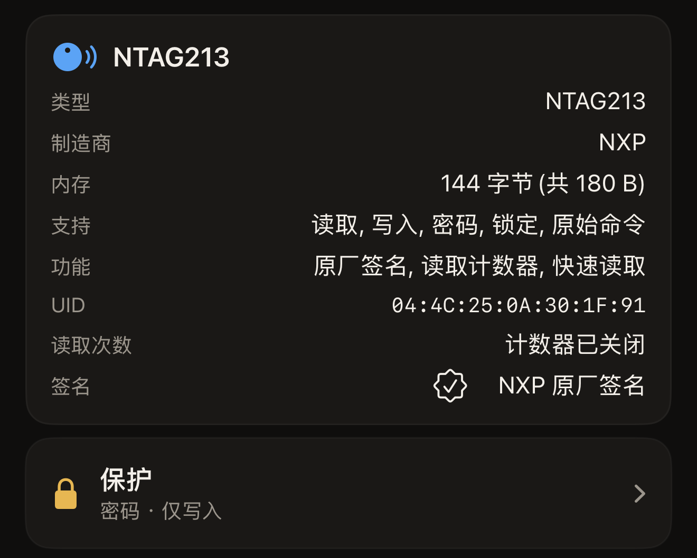

贴在海报上的标签会应答每一部靠近它的手机，而未受保护的芯片允许其中任何一部覆盖你写入的内容。保护是芯片自身给出的对策。密码或密钥存放在芯片的配置页中，在收到密码或密钥之前，芯片会拒绝一切更改。Hex NFC 可以在 iPhone 上设置密码或密钥，在之后扫描时发送它，也可以再把它移除。这道保护在标签上，而不在应用里。

## 受保护的标签拒绝的操作

保护默认只针对写入。以这种方式受保护的标签仍然可以被任何手机读取，这正适合海报或名片：人们贴合标签就能拿到链接，除了你，没有人能更改它。有两个芯片系列还可以把保护扩展到读取，这会改变之后每一次扫描能做的事。

[扫描标签](scan-a-tag.md)。在支持保护的芯片上，「标签」界面打开时会显示两张卡片。标签信息卡片显示你手中芯片的名称，**保护**卡片则管理这道保护。点按**保护**，同名的面板就会打开，上面列有各项设置。[用密码保护标签](protect-a-tag.md)介绍了设置的步骤。

读保护只属于两个芯片系列。在 NTAG213、NTAG215、NTAG216 或 MIFARE Ultralight EV1 上，这项设置是**高级**下的**读取时也需要密码**。打开它会把保护扩展到读取。面板把后果说得很直白：“读保护的标签在没有密码时无法回读,包括校验在内。”在 NTAG424 DNA 上，这项设置是**读取时也需要密钥**，它就在密钥旁边，而不在**高级**下。ICODE SLIX2 和 MIFARE Ultralight C 没有这项设置：它们的密码或密钥保护写入，读取保持开放。

「标签」界面上的**保护**卡片用一行摘要说明扫描的结果。“关闭”表示扫描已确认标签未设置密码或密钥。“密码 · 仅写入”表示写入受保护、读取开放，“密码 · 读取与写入”表示两者都受保护。第四种结果是“未知 · 无法读取此标签的保护状态”，它与“关闭”不同：标签没有给出答案。请再次扫描标签，因为贴合提前结束时，应用就得不到答案。如果应用无法查询某种芯片的保护状态，它每次都会报告同样的结果。对这样的标签尝试写入仍然是安全的。受保护的标签会拒绝写入，写入界面会要求你提供密码或密钥，而不会更改任何内容。在手上没有密码的情况下扫描受读保护的标签，会显示“此标签需要先提交密码，才会显示任何内容。”

:::figure[标签信息卡片显示芯片名称，它下方的**保护**卡片给出摘要，这里是“密码 · 仅写入”。]

:::

## 可以设置密码或密钥的芯片

密码或密钥的形式取决于芯片，应用请你输入它的栏也随之不同。这个栏位于解锁提示上，而解锁提示会在标签拒绝你时出现。受保护的标签不应答扫描时，栏的上方会显示“标签已受保护”，下方是**解锁并重新扫描**。向受保护的标签写入时，应用也会先这样询问，然后才继续。

:::table[各芯片系列的密码或密钥形式]
| 芯片 | 密码或密钥 | 解锁提示中的栏 |
| --- | --- | --- |
| NTAG213、NTAG215、NTAG216、MIFARE Ultralight EV1 | 4 字节密码 | **标签密码(4 字节)** |
| NTAG424 DNA | 16 字节 AES 密钥 | **标签密钥(AES,16 字节)** |
| MIFARE Ultralight C | 16 字节 3DES 密钥，仅保护写入 | **标签密钥(3DES,16 字节)** |
| ICODE SLIX2 | 4 字节密码，仅保护写入 | **标签密码(4 字节)** |
:::

这些栏都以十六进制接受密码或密钥，每个字节两个字符：4 字节密码为 8 个字符，16 字节密钥为 32 个字符。字节之间可以有空格或冒号，大小写均可，因此 `FF FF FF FF` 和 `ffffffff` 是同一个密码的两种输入方式。输入的字节数正确后，栏会显示“有效”；在此之前，它会一直提示需要多少字节。

扫描到的芯片如果完全没有密码机制，就不会显示**保护**卡片，除非扫描发现锁定位已烧录。有了锁定结论，卡片会重新出现来显示它，内容为“已永久锁定”“部分锁定 · 此标签的一部分已永久变为只读”或“锁定已写入 · 请再次扫描以确认”。在已锁定的标签上，卡片只报告结果，无法打开。在尚未扫描任何标签时，「标签」界面上也有这张卡片，预设就是通过它获得保护设置的。你手中是哪种芯片，仍然显示在标签信息卡片上。[适用于 Hex NFC 的标签](tags-that-work.md)介绍了每种芯片的其他功能。各芯片的完整情况见[芯片支持矩阵](../developer/chip-support-matrix.md)。

MIFARE Ultralight C 上的读保护会把应用用来识别芯片的那些页隐藏起来。这样设置的标签再也无法被识别，更不用说解锁了。应用把只能设置写保护这一限制说得很明白：“Hex NFC 可以为此标签设置写保护，但无法设置读保护。”

## 丢失的密码为何无法恢复

标签的密码或密钥无法从外部以任何方式恢复。对于 4 字节密码，应用自己的警告已经说明了一切：“一旦丢失密码,受保护的内存就没了。无法恢复。”使用密钥的芯片说得更详细，意思相同：“一旦丢失此密钥,你将永远无法重写此标签。NTAG424 没有出厂重置。请妥善保管。”以及“一旦丢失此密钥,受保护的内存将永远无法重写。Ultralight C 没有出厂重置。请妥善保管。”SLIX2 的密码只能通过发送当前密码来重置，所以丢失它的结果也一样。

你随预设保存的密码或密钥，Hex NFC 只保存在一个地方：“密码或密钥仅存储在本设备(钥匙串)中。它不会同步,也不会随导出文件外流。”因此，分享给他人或在另一部 iPhone 上恢复的预设不会带有密码。[将标签另存为预设](presets.md)说明了这对在一批标签上重复使用同一个预设意味着什么。请自己保留一份副本，存放在你信任的地方。

## 更改保护需要贴合两次

::include[two-tap-confirmation]

你不必另外去查找这个 UID。应用会在“请输入此标签的 UID 以确认。”下方、栏的旁边显示它，形式是一串不带分隔符的十六进制字符。输入时大小写均可。设置密码或密钥和移除密码或密钥都是对标签的更改，所以都要经过这一步确认。

## 另请参阅

- [扫描标签](scan-a-tag.md)
- [用密码保护标签](protect-a-tag.md)
- [移除标签的密码](remove-password.md)
- [限制密码错误次数](attempt-limit.md)
- [永久锁定标签](permanent-lock.md)
