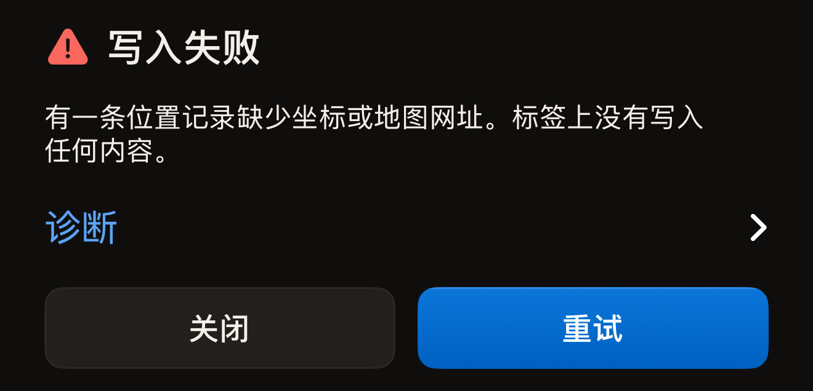
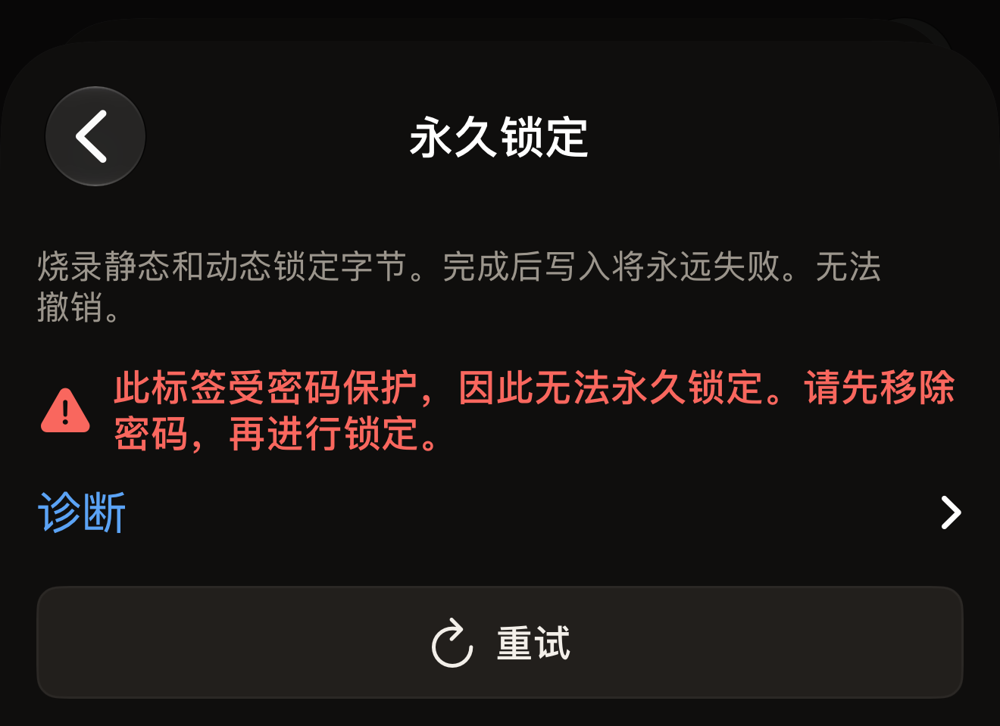

读取失败几乎都是因为标签移动了。请将 iPhone 顶部平贴在标签上，保持不动约一秒，然后点按**重试**。

Hex NFC 会用一句话说明出了什么问题，而不是显示错误代码。请在下文中找到你看到的那句话。每条失败提示的正下方都有一个收起的**诊断**行，右侧带有一个箭头图标。点按该行，技术细节就会在它下方展开。

## 查找你看到的提示

- [超时、读取中途丢失标签或已取消](#scan-stopped)
- [MIFARE Classic、此设备不支持 NFC、版本未获授权、标签不支持该操作，或健康设备](#tag-not-readable)
- [记录太大，或标签回读的内容不一致](#write-failed)
- [输入标签的 UID 后提示是另一枚标签](#different-tag)
- [密码检查未完成](#password-check)
- [发生了意外错误](#unexpected)

## 先试试这些方法

- 将 iPhone 顶部贴在标签上，而不是机身背面的中部。
- 取下 iPhone 的金属保护壳，并让标签离开任何金属表面。
- 让标签和 iPhone 一起保持不动，直到应用给出响应。
- 换一枚标签试试。如果第二枚能读取，问题就出在第一枚标签上。

## “扫描失败”是什么意思？ {#scan-failed}

“扫描失败”是应用无法完成读取时显示的标题。标题下方的句子会说明原因，本页下面的各个标题也按原因分组。

::::steps
:::step[展开诊断]
点按提示正下方的**诊断**行。详细信息会在下方展开，其中的文字可以选中，便于复制。
:::

:::step[开始新的扫描]
点按**重试**。扫描界面会开启新的会话，并显示“将标签贴近 iPhone 顶部”等待标签。
:::

:::step[让标签保持不动]
将 iPhone 顶部平贴在标签上，保持不动，直到应用给出响应。
:::
::::

## 扫描为什么中途停止？ {#scan-stopped}

“扫描超时。请将标签稳定贴在手机顶部后重试。如果某个标签每次都超时,它可能是 iPhone 无法读取的 MIFARE Classic(这是 iOS 的限制,并非标签故障)。”

iOS 结束了会话，因为在会话的时限到达之前一直没有标签应答。如果 iPhone 已在同一界面上找到过标签（例如在受保护标签的第二次贴合时），或者该界面上之前的一次尝试以错误结束，你就会看到这句话。请将 iPhone 顶部缓慢移过标签，然后停在那里。

如果 iPhone 根本没有找到标签，界面会改为显示“未找到标签”，下方是**重试**。这不算失败，因此下方没有诊断信息。解决方法相同：将 iPhone 顶部平贴在标签上，保持不动。

如果标签开始应答后又停止，提示会不同：“读取过程中丢失标签。请将其贴紧手机顶部后重试。”这表示标签在某条命令执行到一半时离开了感应范围。

“扫描已取消。”表示扫描在完成前被关闭了，可能是你关闭的，也可能是应用关闭的。如果 iPhone 已在同一界面上找到过标签，或者该界面上之前的一次尝试以错误结束，就会出现这条提示。在找到任何标签之前关闭 iOS 面板，面板会直接关闭，不显示任何提示。扫描只读取数据，因此标签上没有任何改动。

## 为什么 iPhone 完全无法读取这枚标签？ {#tag-not-readable}

有三条提示表示无论怎样贴近标签，都无法读取。这里还列出了另外两条，它们都不是读取失败。

“这似乎是 MIFARE Classic 标签。iPhone 能检测到它,但无法读取其加密内存:iOS 不会开放任何应用所需的 MIFARE Classic 密钥。”芯片的应答足以让应用识别出芯片系列，但仅止于此。

:::important[iPhone 上没有任何应用能读取 MIFARE Classic]
iOS 不会向任何应用提供解锁这种芯片内存所需的密钥，因此 Hex NFC 中没有任何设置能改变这一结果。请改用[适用于 Hex NFC 的标签](tags-that-work.md)中列出的标签。
:::

“此设备不支持 NFC。”应用根本无法在这部 iPhone 上开启 NFC 会话。iPhone 没有可以重新打开的 NFC 开关，Hex NFC 中也没有任何设置能改变这一点，换一种方式贴近标签同样无济于事。应用的运行要求见[常见问题](faq.md)。如果这条提示出现在一部能正常运行 Hex NFC 的 iPhone 上，请展开**诊断**并复制其中的文字，然后按[如需更多帮助](#if-you-need-more-help)中的说明发送。

“此版本尚未获授权读取该类型的标签。”你安装的应用版本未注册读取这类标签。无论是标签本身还是贴近的方式，都无法改变这一点。请先在 App Store 中检查 Hex NFC 是否有更新。如果这条提示再次出现，请展开**诊断**，按[如需更多帮助](#if-you-need-more-help)中的说明发送其中的文字。

“此标签不支持该操作。”这条提示与读取无关。标签已经读取成功，它不支持的是你通过当前途径请求的操作。标签信息卡片会列出芯片名称。如果芯片提供了相关信息，卡片上的**支持**和**功能**行会说明它能做什么。

**操作** > **用密码保护**和「标签」界面上的**保护**卡片都能保护七种芯片：NTAG213、NTAG215、NTAG216、MIFARE Ultralight EV1、MIFARE Ultralight C、NTAG424 DNA 和 ICODE SLIX2。[用密码保护标签](protect-a-tag.md)介绍了这两种途径。应用能识别的芯片见[适用于 Hex NFC 的标签](tags-that-work.md)。[芯片支持矩阵](../developer/chip-support-matrix.md)逐一列出了每种芯片的完整技术细节。

“这是一台健康设备。Hex NFC 从不向健康设备写入数据，也不会向它们发送命令。”表示你贴近的是一台医疗设备，例如胰岛素笔。针对它的写入、操作或**高级**控制台命令会在写入任何内容、发出你的命令之前停止，因此设备不会有任何改变。用**扫描**扫描它会打开**健康设备**界面，详见[健康设备](tags-that-work.md#health-devices)。

## “写入失败”是什么意思？ {#write-failed}

“写入失败”是写入、回读或保护更改未能完成时显示的标题。标题下方有三个控件：**诊断**包含详细信息，**关闭**会让你返回编辑器，**重试**会再次执行写入，并保留你输入的密码。如果是从「标签」界面发起、会打开或关闭保护的写入，重试时会再次读取标签的 UID，并要求你再输入一次。你对更改标签的同意不会在失败后延续。从**库**写入的预设不需要这样确认：你贴近哪枚标签，就表示要写入哪枚标签，因此重试时会直接回到贴合一次的流程。

:::figure[写入失败时，“写入失败”下方会说明原因，再下方是**诊断**，以及并排的**关闭**和**重试**。]

:::

其中两条提示有各自的解决方法。

“这些记录对此标签来说太大了。”你的记录所需的空间超过了芯片数据区的容量。请缩短或删除一条记录，或者写入内存更大的标签。各类记录占用多少空间，见[记录类型](record-types.md)。

“标签回读的内容与写入的不一致。请重新写入。”应用在写入后回读了标签，读到的字节与发送的不一致。请让标签保持不动，然后点按**重试**。

## 为什么输入标签的 UID 后标签被拒绝了？ {#different-tag}

::include[two-tap-confirmation]

“这是另一个标签。”表示你贴近的标签不是应用预期的那枚。**诊断**行会注明是哪一次贴合触发了这条提示，以及预期的是哪枚标签。

在**操作**界面上，这条提示出现在第二次贴合时，表示你贴近的标签不是你输入了 UID 的那枚。请再次贴近同一枚标签，或者用你要更改的那枚标签重新开始。

从「标签」界面更改保护时，两次贴合都可能出现这条提示。第二次贴合时出现，含义与上面相同。第一次贴合时你还没有输入任何内容，这时它表示你贴近的标签不是打开编辑器时所用的那枚。请改为贴近那枚标签。

在**操作**界面上，操作失败时会先显示提示，正下方是**诊断**，再下方是**重试**。有两个界面会替换这个按钮：**尝试次数上限**显示**重新开始**，**移除密码**显示**输入其他密码**。这两个按钮都会重新要求输入密码，因此下一次尝试发送的是你接下来输入的密码，而不是标签刚刚拒绝的那个。

:::figure[在**永久锁定**界面上，锁定被拒绝时会依次显示提示、**诊断**和**重试**。]

:::

## 密码检查未完成怎么办？ {#password-check}

“无法检查密码：标签停止应答。请将它稳稳贴住手机顶部后重试。”应用检查密码时，标签停止了应答，因此无法判断密码是否正确。应用并不是在告诉你密码错了。请稳稳贴住标签，然后重新执行该操作。如果密码确实已经无法打开标签，请参阅[移除标签的密码](remove-password.md)。

## 为什么提示说发生了意外错误？ {#unexpected}

“发生了意外错误。”会出现在扫描界面、写入界面和**操作**界面上。当某次失败不属于应用能识别的标签错误时，就会显示这条提示。“发生了意外情况。请重试。”出自 NFC 层，原因相同。

另外两条提示表示标签的应答形式不符合应用的预期：

- “标签的响应不符合预期协议。”
- “标签返回了本应用无法解析的数据。”

遇到这四条提示，下一步都一样：展开**诊断**，复制其中的文字，然后再次贴近标签。如果同一枚标签再次出现相同的提示，复制下来的诊断信息就能确定故障所在。

## 如需更多帮助 {#if-you-need-more-help}

请在应用中把复制的诊断信息发送给 Hex Pro：在主屏幕上点按齿轮按钮，然后点按**发送反馈**，把诊断信息粘贴到消息中。如果标签已读取到显示标签信息卡片的程度，请附上卡片上的芯片名称；如果标签根本无法读取，也请说明，并说明哪些标签可以读取，哪些不能。表单会自动附上应用版本、iOS 版本、设备型号和语言。如果希望收到回复，请在**回复地址（可选）**中填写你的电子邮件地址。[反馈与评分](settings.md#feedback-and-ratings)介绍了这个表单。

你也可以发邮件到 `support@hex.pro`，这个地址写在**设置**的**法律信息**下的**隐私政策**和**条款与条件**中。通过邮件联系时，请附上**设置**中**版本**一栏显示的应用版本，以及 iPhone 型号和 iOS 版本（可在 iPhone 上的“设置”应用中依次前往通用、关于本机查看）。

接下来，可以阅读[扫描标签](scan-a-tag.md)，了解正常的读取是什么样子；或者阅读[常见问题](faq.md)，了解应用最基本的运行要求。
