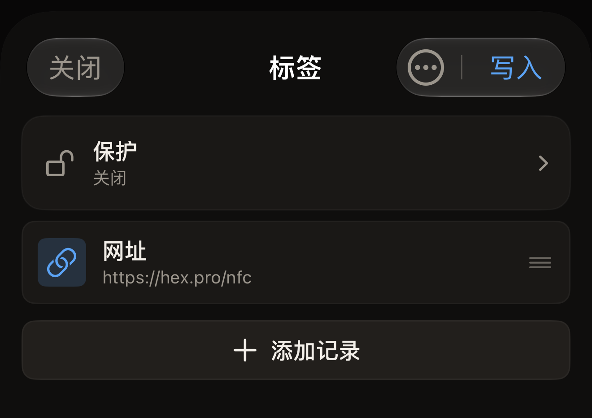
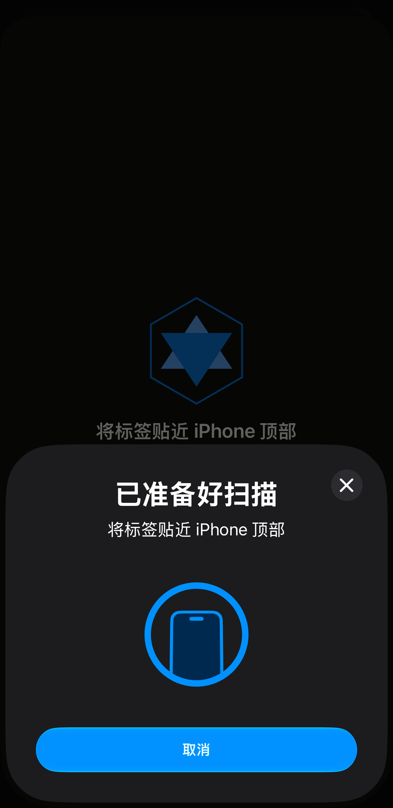

标签可以存储网址，读取标签的手机会提示打开这个网址。在 Hex NFC 中，网址是一条网址记录。你先在 iPhone 上创建这条记录，然后将标签贴近 iPhone 一次，把记录传到标签上。

开始之前，请准备好标签。如果不确定标签是否仍可写入，请先按照[扫描标签](scan-a-tag.md)中的说明扫描它。扫描会打开「标签」界面。如果标签仍可写入，该界面上的**写入**就可以点按。如果应用回读后发现标签已永久锁定，**写入**会呈灰色，因为这种标签会拒绝所有写入。点按**关闭**离开该界面，回到 Hex NFC 主屏幕，然后从第 1 步开始。

## 将链接写入空白标签

:::::steps
::::step[开始创建]
在主屏幕上点按**创建**。「标签」界面随即打开，“空标签”标题下没有任何记录。
::::

::::step[添加网址记录]
点按**添加记录** > **网址**。记录编辑器随即打开这条新记录。
::::

::::step[输入网址]
在**网址**中输入带协议前缀的地址，例如 `https://hex.pro`，然后点按**保存**。这条记录会出现在列表中。应用会完全按照你输入的内容写入地址，不会添加任何东西。写入标签的地址如果缺少 `https://`，就不是有效的链接。读取这枚标签的手机没有可以打开的网页。

:::figure[点按**保存**后，「标签」界面会列出新的**网址**记录，右上角的**写入**已经可以点按。]

:::
::::

::::step[将记录发送到标签]
点按「标签」界面顶部的**写入**。写入界面随即打开，并显示“将标签贴近 iPhone 顶部”。iOS 会在应用上方显示它自己的扫描面板，面板上也是这行字。

:::figure[写入界面的提示行仍显示在 iOS 扫描面板上方，面板重复了这行提示，并带有它自己的取消按钮。]

:::
::::

::::step[将标签贴近 iPhone]
将 iPhone 顶部贴在标签上，保持不动。界面先显示“正在写入…”，然后显示“正在校验…”。这一步不会锁定标签，你可以随时再次覆盖写入，次数不限。成功时显示的“写入完成”只表示记录已经写入，并且回读结果完好无损。随后界面会自动关闭，回到「标签」界面。
::::
:::::

写入会替换标签上原有的全部内容。如果想保留标签上已有的部分内容，请先扫描它。然后编辑那份记录列表，而不是新建一份，具体做法见[编辑标签的记录](edit-records.md)。

:::tip[任何记录类型的写入方式都相同]
链接是标签上最常见的内容，也是你可以添加的 13 种记录之一。[记录类型](record-types.md)列出了所有类型，无论你选择哪一种，上面的步骤都相同。
:::

## 应用在报告成功之前会检查什么

应用从不轻信标签对写入的确认。它会发送记录，再次读取标签，并将回读的内容与发送的内容进行比较。“写入完成”表示回读时，标签中的内容与你写入的完全一致。

有一种状态会让写入停下来，而不是完成写入。如果标签的记录受密码保护，写入界面会显示“标签已受保护”，并在写入任何内容之前要求输入密码。在**标签密码(4 字节)**中输入密码，然后点按**解锁并写入**。接着再次将标签贴近 iPhone 顶部。第二次贴合会完成认证并写入。如果你保护这枚标签时应用就已保存了密码，它会跳过这个提示，贴合一次即可完成写入。如果你不知道密码，请点按**取消**：你的记录会保留在「标签」界面上。关于密码对标签的作用，请参阅[标签保护](tag-protection.md)。

如果标签缺少存放记录所需的头部信息，写入之前并不会被拦下。应用会发送记录，但回读时在标签上找不到任何可读的内容，写入最终显示“写入失败”。

避免这种情况的办法是先扫描。对于应用扫描后识别为未格式化的标签，「标签」界面会在记录列表上方显示“此标签未格式化”，下方是“它没有 Capability Container,现在写入的记录将无法读取。请先格式化。”点按这条提示即可打开「操作」界面并格式化标签。从**创建**开始的标签没有经过扫描，因此「标签」界面无从发出警告。

修复不会让你已创建的记录丢失。点按「标签」界面右上角的菜单按钮，然后点按**操作…**。「操作」界面会在「标签」界面上方打开。关闭它后，你的记录仍然都在。请参阅[擦除或格式化标签](erase-or-format.md)。

如果想在写入开始前停止，请在写入界面仍在等待标签时点按**取消**，你的记录会保留在「标签」界面上。在读取到任何标签之前点按 iOS 面板上的取消，效果也一样。如果没有标签贴近 iPhone，iOS 面板会在大约一分钟后自动关闭，写入界面会显示“未找到标签”，并提供**关闭**和**重试**。

## 写入失败时

如果写入失败，或者回读的内容与发送的内容不同，界面会显示“写入失败”，并在下方说明原因。此时：

- 要再次发送相同的记录，请点按**重试**。你已经输入的内容都会保留。
- 要不写入就返回「标签」界面，请点按**关闭**。

一直拒绝写入的标签，可能不适合你要写入的内容。[适用于 Hex NFC 的标签](tags-that-work.md)说明了应用能识别哪些芯片，[芯片支持矩阵](../developer/chip-support-matrix.md)则列出了每种芯片的详细信息。

## 另请参阅

- [编辑标签的记录](edit-records.md)
- [将标签另存为预设](presets.md)
- [标签无法扫描或写入时](troubleshooting.md)
